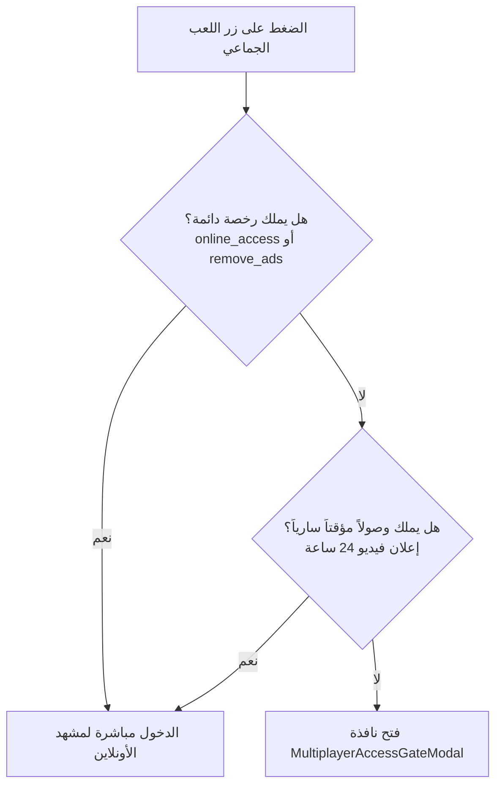

# دليل الإعداد والتكامل الشامل لمتجر اللعب الفردي ونظام الشراء الرقمي (IAP) وبوابة اللعب الجماعي
# Complete Single-Player Store, Economy, IAP, and Multiplayer Access Gate Guide

تم إعداد هذا التوثيق الفني الشامل باللغة العربية ليوثق بدقة واحترافية كافة جوانب النظام الذي تم إكماله وتكامله داخل مشروع **Shootx** على محرك **Unity 6 (6000.3.11f1)** بالاعتماد على **Unity IAP v5** و **DOTween Pro** و **TextMeshPro**.

---

## فهرس الأقسام الرئيسية
- [القسم أ: ما كان موجوداً وما تم إكماله وتكامله (Audit & Completed Integrations)](#القسم-أ-ما-كان-موجوداً-وما-تم-إكماله-وتكامله)
- [القسم ب: نظام معاينة وتجهيز الأسلحة والأزياء فورياً (Immediate Visual Preview & Equipment)](#القسم-ب-نظام-معاينة-وتجهيز-الأسلحة-والأزياء-فورياً)
- [القسم ج: تكامل نافذة متجر الشراء الرقمي (ShopPopup)](#القسم-ج-تكامل-نافذة-متجر-الشراء-الرقمي-shoppopup)
- [القسم د: نافذة الإعدادات وزر إزالة الإعلانات (Settings Popup - Remove Ads)](#القسم-د-نافذة-الإعدادات-وزر-إزالة-الإعلانات-settings-popup---remove-ads)
- [القسم هـ: التحقق من شراء الوصول للأونلاين (Online Access Verification)](#القسم-هـ-التحقق-من-شراء-الوصول-للأونلاين-online-access-verification)
- [القسم و: نظام الشراء ودورة حياة المعاملات (IAPManager & Transaction Lifecycle)](#القسم-و-نظام-الشراء-ودورة-حياة-المعاملات-iapmanager--transaction-lifecycle)
- [القسم ز: إدارة البيانات والاقتصاد (GameDataManager & Economy)](#القسم-ز-إدارة-البيانات-والاقتصاد-gamedatamanager--economy)
- [القسم ح: تفاصيل ومحتويات الحزم الستة (Bundle Contents & Inspector Editing)](#القسم-ح-تفاصيل-ومحتويات-الحزم-الستة-bundle-contents--inspector-editing)
- [القسم ط: إدارة صور وأيقونات المنتجات (Product Artwork & Placeholder Handling)](#القسم-ط-إدارة-صور-وأيقونات-المنتجات-product-artwork--placeholder-handling)
- [القسم ي: بوابة الوصول للعب الجماعي (Multiplayer Access Gate)](#القسم-ي-بوابة-الوصول-للعب-الجماعي-multiplayer-access-gate)
- [القسم ك: إعداد المتاجر الخارجية (Google Play Console & App Store Connect)](#القسم-ك-إعداد-المتاجر-الخارجية-google-play-console--app-store-connect)
- [القسم ل: قائمة التحقق والاختبار الشاملة (Testing Checklist)](#القسم-ل-قائمة-التحقق-والاختبار-الشاملة-testing-checklist)

---

## القسم أ: ما كان موجوداً وما تم إكماله وتكامله

### 1. ما تم العثور عليه في المشروع (Audit Findings):
- **الأصول:** 14 سلاحاً ثلاثي الأبعاد في `Assets/Store/Weapons/` و 13 زياً/شخصية في `Assets/Store/Outfits/`.
- **المشهد والواجهات:** واجهات `GunsPanel` و `OutfitsPanel` و `ShopPopup` و `Settings Popup` موجودة داخل مشهد `Assets/Scenes/Main.unity`.
- **حزمة IAP:** تم العثور على إصدار **Unity IAP v5** معتمد رسمياً في المشروع مع ملفات المنتجات `IAPProductCatalog.json`.
- **مشكلة المعاينة:** كانت واجهات الأسلحة والأزياء تملك كائنات `PlayerPreview` ترتبط بملف `PlayerPreview.renderTexture`، لكن لم تكن هناك كاميرا أو مسرح معاينة حقيقي يرسم المجسمات داخله، ولم تكن المعاينة تتغير فور الضغط على البطاقة.
- **مشكلة زر إزالة الإعلانات في الإعدادات:** كان الزر `NoAdsButton` في `Settings Popup` غير مكتمل، ويشير إلى معرف خاطئ `"no_ads"` بدلاً من المعرف الرسمي للكتالوج `"remove_ads"`.
- **مشكلة نافذة الشراء الرقمي (ShopPopup):** لم تكن الحزم الستة وحزم العملات مربوطة بأزرار الشراء الفعلي وعرض الأسعار المحلية وحالات المعالجة.
- **مشكلة الفصل بين الحالات:** كان اختيار العنصر في المتجر يتداخل مع التجهيز والملكية الفورية.

### 2. ما تم إنجازه وتكامله بالكامل (Completed Integrations):
1. **إنشاء نظام المعاينة الفوري المنفصل (`StorePreviewManager`):**
   - مسرح معاينة 3D مستقل في الفضاء المنعزل `(0, -500, 0)` مزود بإضاءة وكاميرا خاصة به ترسم مباشرة داخل `Assets/Resources/PlayerPreview.renderTexture`.
   - بمجرد الضغط على أي بطاقة سلاح أو زي، يتم تحديث المعاينة فورياً دون الحاجة لإعادة فتح المتجر، ودون التأثير على اللاعب الفعلي.
   - إضافة إمكانية تدوير المجسم بزاوية 360 درجة عبر السحب باللمس أو الماوس (`StorePreviewDragRotator`).
2. **فصل الحالات الثلاث بدقة (Selection, Ownership, Equipped):**
   - **الاختيار للمعاينة (Selection):** يُظهر المجسم والبيانات فوراً، ولا يخصم أي عملات ولا يمنح ملكية.
   - **الملكية (Ownership):** عند شراء العنصر غير المملوك بالعملة العادية أو عبر حزمة، تُحفظ ملكيته فوراً ويتحول الزر إلى `EQUIP`.
   - **التجهيز (Equipped):** عند الضغط على `EQUIP`، يُحفظ المعرف وتُطلق إشارة الحدث `GameDataManager.OnEquipmentChanged` ليتم تحديث الشخصية في اللعب الفردي فوراً عبر `PlayerEquipmentApplier`.
3. **تكامل نافذة `ShopPopup` بالكامل:**
   - ربط جميع الحزم الستة (`package_01` إلى `package_06`) وعرض تفاصيل محتوياتها ومؤشر العناصر المملوكة `(OWNED)`.
   - ربط حزم العملة الذهبية الأربعة (`coins_200`, `coins_500`, `coins_1200`, `coins_2500`) مع الأسعار المحلية وإضافة العملات بعد نجاح الشراء فقط.
   - ربط بطاقات الوصول الدائم `online_access` و `remove_ads`.
   - زر استرجاع المشتريات `Restore Purchases` لنظام iOS.
4. **تكامل زر `NoAdsButton` في `Settings Popup`:**
   - ربط الزر بـ `remove_ads` وعرض السعر المحلي.
   - منح إزالة الإعلانات الإجبارية بالإضافة إلى منح وصول دائم للعب الجماعي في آن واحد، وتغيير حالة الزر إلى `ADS REMOVED` وإيقاف تفعيله عند التملك.
5. **بوابة اللعب الجماعي الآمنة:**
   - التكامل حصرياً عند مدخل اللعب الفردي (`MainMenuController.OnOnlinePressed`).
   - لا توجد أي شفرات مقاطعة داخل خرائط أو مشاهد الأونلاين؛ إذا انتهت مهلة الـ 24 ساعة المؤقتة للاعب وهو داخل معركة أونلاين، يستمر لعبه دون أي انقطاع.

---

## القسم ب: نظام معاينة وتجهيز الأسلحة والأزياء فورياً

### 1. مسرح المعاينة الفوري (`StorePreviewManager.cs`)
- **الموقع:** `Assets/Scripts/Store/StorePreviewManager.cs`
- **آلية العمل:**
  - يعمل كـ Singleton ذاتي التوليد (`StorePreviewManager.Instance`).
  - ينشئ مسرحاً معزولاً عند الإحداثيات `(0, -500, 0)` بعيداً عن مشاهد اللعب لتفادي أي تداخل.
  - يحتوي على كاميرا موجهة نحو مجسم الشخصية ومضبوطة لترسم على `PlayerPreview.renderTexture`.
  - الواجهتان `GunsPanel` و `OutfitsPanel` تملكان عنصر `RawImage` يعرض هذه الـ RenderTexture.
- **التفاعل الفوري:**
  - عند اختيار سلاح: `StorePreviewManager.Instance.ShowWeaponPreview(gunNumericId)` يستبدل السلاح المحمول في يد مجسم المعاينة فورياً.
  - عند اختيار زي: `StorePreviewManager.Instance.ShowOutfitPreview(outfitNumericId)` يغير الموديل أو الزي فورياً.
  - عند إغلاق المتجر: يتم إيقاف رندرة المعاينة تلقائياً (`StorePreviewManager.Instance.ClosePreview()`) لتوفير أداء المعالج والبطارية.
- **التدوير بالسحب (`StorePreviewDragRotator.cs`):**
  - تم ربط السكربت بمساحة المعاينة `CharacterHolder` لتمكين اللاعب من تدوير الشخصية بالسحب باللمس أو الماوس.

### 2. تطبيق العتاد على اللاعب الفعلي (`PlayerEquipmentApplier.cs`)
- **الموقع:** `Assets/Scripts/Store/PlayerEquipmentApplier.cs`
- **التكامل في مشهد اللعب:**
  - متصل بكائن اللاعب الفردي (`Player`).
  - يستمع للحدث الثابت: `GameDataManager.OnEquipmentChanged`.
  - عند تجهيز أي سلاح أو زي في المتجر، يُستدعى `ApplyCurrentEquipment()` فوراً:
    1. تفعيل مجسم الزي المختار من مصفوفة الشخصيات التابعة لكائن `Models`.
    2. وضع مجسم السلاح تحت عظمة اليد والارتباط `Gun`.
    3. تحديث مرجع نقطة الإطلاق `WeaponFirePoint` في سكربت الرماية `ShootingSystem` تلقائياً لمنع أي أخطاء في مسار الرصاصات.
- **العتاد الافتراضي:**
  - إذا كان ملف الحفظ جديداً أو مفقوداً، يتم تلقائياً تفعيل السلاح الافتراضي (ID: 0) والزي الافتراضي (ID: 0) بحيث لا يبقى اللاعب أبداً بدون عتاد صالح.

---

## القسم ج: تكامل نافذة متجر الشراء الرقمي (ShopPopup)

### 1. الهيكلية وعناصر الواجهة
- **الموقع:** كائن `ShopPopup` تحت الـ Canvas الرئيسي في `Assets/Scenes/Main.unity`.
- **السكربت المسؤول:** `ShopPopupController.cs`.
- **نظام التبويبات الثلاث:**
  1. **COIN PACKS (حزم العملات الذهبية):**
     - 4 بطاقات: `coins_200`, `coins_500`, `coins_1200`, `coins_2500`.
     - يعرض اسم المنتج، عدد العملات الذهبية الممنوحة، والسعر المحلي (`localizedPriceString`).
     - لا تُضاف العملات إلى العداد إلا بعد استلام إشعار النجاح الرسمي من `IAPManager`.
  2. **BUNDLES (حزم التوفير الستة):**
     - 6 أزرار للحزم: `package_01` إلى `package_06`.
     - صندوق المعاينة التفصيلي: يعرض اسم الحزمة، وصفها، قائمة العناصر المتضمنة فيها مع حالة كل عنصر `(OWNED)` إن كان مملوكاً مسبقاً أو `(NEW)`.
     - زر الشراء: يعرض السعر المحلي، ويتحول إلى `OWNED` غير قابل للضغط إذا كانت جميع عناصر الحزمة مملوكة مسبقاً.
  3. **ONLINE PASSES (رخص الأونلاين وإزالة الإعلانات):**
     - بطاقة `online_access`: وصول دائم للعب الجماعي.
     - بطاقة `remove_ads`: إزالة الإعلانات الإجبارية + وصول دائم للعب الجماعي.
     - تتحول البطاقة إلى `OWNED` عند تملك الميزة مسبقاً لمنع الشراء المزدوج.

### 2. منع المعاملات المزدوجة والتغذية البصرية
- أثناء معالجة الشراء، يتم تعطيل أزرار الشراء مؤقتاً وعرض نص حالة التحميل (Loading / Processing...).
- بعد نجاح الشراء، يتم تشغيل مؤثر ناعم بواسطة **DOTween Pro** وتحديث رصيد العملات الذهبية أو عناصر المخزون فوراً.
- في حال الإلغاء أو الفشل، تظهر رسالة للمستخدم ولا يتم تعديل أي من الأرصدة أو التراخيص.

---

## القسم د: نافذة الإعدادات وزر إزالة الإعلانات (Settings Popup - Remove Ads)

### 1. الكائن والربط الفعلي
- **الموقع:** الزر الأصلي الموجود في المشهد: `Canvas > Settings Popup > Panel > NoAdsButton`.
- **السكربت المسؤول:** `SettingsPopupController.cs`.
- **معرف المنتج الرسمي:** `remove_ads` (Non-consumable).

### 2. سلوك الزر والامتيازات الممنوحة
1. **عند عدم التملك:**
   - يقرأ السعر المحلي من المتجر ويعرضه: `REMOVE ADS ($X.XX)`.
   - عند الضغط، يستدعي `IAPManager.Instance.BuyProduct("remove_ads")`.
2. **عند نجاح الشراء أو استرجاع المشتريات:**
   - يمنح إزالة الإعلانات الإجبارية: `GameDataManager.Instance.SetAdsRemoved(true)`.
   - يمنح وصولاً دائماً لطور اللعب الجماعي: `MultiplayerAccessManager.GrantPermanentAccess()`.
   - يحفظ الامتيازين في الذاكرة الدائمة فوراً.
   - يتغير نص الزر إلى `<color=#00FF88>ADS REMOVED</color>` مع إيقاف خاصية التفاعل (`interactable = false`).
   - الإعلانات بمكافأة (Rewarded Ads) تظل تعمل للاعبين الراغبين بالحصول على مكافآت اختيارية إضافية.

---

## القسم هـ: التحقق من شراء الوصول للأونلاين (Online Access Verification)

- **معرف المنتج:** `online_access` (Non-consumable).
- **السكربتات المرتبطة:** `ShopPopupController.cs` و `MultiplayerAccessGateModal.cs`.
- **التحقق والتأكيد:**
  - شراء هذا المنتج يمنح ترخيص اللعب الجماعي الدائم: `MultiplayerAccessManager.GrantPermanentAccess()`.
  - شراء `online_access` **لا يزيل الإعلانات**، حيث تظل الإعلانات العادية تعمل في اللعب الفردي ما لم يقم بشراء `remove_ads`.
  - لا توجد أي كودات مكررة للشراء؛ كافة الواجهات توجه طلب الشراء عبر الدالة المركزية `IAPManager.Instance.BuyProduct("online_access")`.

---

## القسم و: نظام الشراء ودورة حياة المعاملات (IAPManager & Transaction Lifecycle)

- **حزمة IAP:** Unity IAP v5 الرسمية الحديثة.
- **المنتجات المسجلة الـ 12:**
  - الحزم: `package_01`, `package_02`, `package_03`, `package_04`, `package_05`, `package_06` (Non-consumable).
  - التراخيص: `online_access`, `remove_ads` (Non-consumable).
  - العملات: `coins_200`, `coins_500`, `coins_1200`, `coins_2500` (Consumable).

### دورة حياة الشراء (Lifecycle):
1. **التهيئة (Initialization):**
   - استدعاء غير متزامن عند بدء اللعبة.
   - إطلاق حدث `OnInitializedEvent` لتحديث نصوص الأسعار في كل الواجهات المفتوحة.
2. **بدء الشراء (Initiating Purchase):**
   - التحقق من تهيئة المتجر وعدم وجود معاملة معلقة حالياً.
3. **معالجة المعاملة ومنع التكرار (Deduplication):**
   - التحقق من معرف المعاملة `TransactionID` مقابل السجل المحفوظ `ProcessedTransactions`.
   - إذا سُجلت المعاملة سابقاً، لا تُمنح العملات الاستهلاكية مرة أخرى منعاً للاحتيال أو أخطاء التكرار.
4. **تأكيد الطلب (Order Confirmation):**
   - بعد منح المكافأة وتخزينها، يتم إنهاء المعاملة رسمياً عبر إشعار متجر Google أو Apple بنجاح التسليم.
5. **استرجاع المشتريات (Restore Purchases):**
   - متاح عبر الزر المخصص في نافذة الشراء الرقمي للأجهزة بنظام iOS لتلبية متطلبات متجر App Store.

---

## القسم ز: إدارة البيانات والاقتصاد (GameDataManager & Economy)

### 1. الفصل الصارم بين العملتين:
- **العملة العادية (Soft Currency):**
  - تُجمع من إنهاء مستويات اللعب الفردي (50–150 عملة لكل مستوى، بمعدل وسطي 100).
  - تُستخدم لشراء الأسلحة والأزياء من المتجر العادي.
  - مخزنة في المفتاح: `Player_SoftCurrency`.
- **العملة الذهبية المميزة (Hard Currency):**
  - تُمنح **فقط** عبر الشراء الحقيقي لحزم العملات من المتجر.
  - لا يمكن كسبها من إنهاء المستويات مطلقاً.
  - مخزنة في المفتاح: `Player_HardCurrency`.

### 2. واجهات برمجة التطبيقات الأساسية (GameDataManager APIs):
```csharp
// رصيد العملات
int soft = GameDataManager.Instance.SoftCurrency;
int hard = GameDataManager.Instance.HardCurrency;
GameDataManager.Instance.AddCoins(amount);       // إضافة عملات عادية
GameDataManager.Instance.AddHardCoins(amount);   // إضافة عملات ذهبية
bool paid = GameDataManager.Instance.SpendCoins(cost); // خصم عملة عادية للشراء

// ملكية الأسلحة والأزياء
bool ownsGun = GameDataManager.Instance.IsGunOwned(gunId);
bool ownsOutfit = GameDataManager.Instance.IsOutfitOwned(outfitId);
GameDataManager.Instance.UnlockGun(gunId);
GameDataManager.Instance.UnlockOutfit(outfitId);

// تجهيز العتاد وتحديث اللعبة فورياً
GameDataManager.Instance.EquipGun(gunId);
GameDataManager.Instance.EquipOutfit(outfitId);
int equippedGun = GameDataManager.Instance.EquippedGunId;
int equippedOutfit = GameDataManager.Instance.EquippedOutfitId;

// التراخيص والإعلانات
bool noAds = GameDataManager.Instance.AdsRemoved;
bool mpAccess = GameDataManager.Instance.MultiplayerUnlocked;
```

---

## القسم ح: تفاصيل ومحتويات الحزم الستة (Bundle Contents & Inspector Editing)

تم إعداد ملفات الحزم في المسار: `Assets/Data/Store/Bundles/`، وتتضمن العناصر الفعلية التالية:

| الحزمة | المعرف (ID) | نوع المحتوى | العناصر المتضمنة فعلياً |
|---|---|---|---|
| **Starter Pack** | `package_01` | أسلحة وأزياء بداية | • مسدس ريفولفر (`wep_revolver_01`)<br>• مسدس رشاش (`wep_machine_pistol_01`)<br>• زي الوحش (`outfit_monster_costume`)<br>• زي المهرج (`outfit_clown`) |
| **Advanced Pack** | `package_02` | تشكيلة متوسطة ممتازة | • مسدس رشاش ج2 (`wep_machine_pistol_02`)<br>• بندقية صغيرة (`wep_rifle_small_01`)<br>• رشاش خفيف (`wep_smg_01`)<br>• زي الحارس (`outfit_ranger`)<br>• زي المتخفي (`outfit_rogue_hooded`) |
| **Elite Pack** | `package_03` | تشكيلة نخبة نادرة | • بندقية قتالية (`wep_rifle_base_01`)<br>• سلاح الإبر (`wep_syringe_gun_01`)<br>• بندقية قنص (`wep_sniper_01`)<br>• زي درويد (`outfit_druid`)<br>• زي الفارس (`outfit_knight`)<br>• هيئة الوحش (`outfit_monster`) |
| **Character Pack** | `package_04` | أزياء ومظاهر فقط | • زي بالادين (`outfit_paladin`)<br>• زي روبوت عادي (`outfit_animatronic_normal`)<br>• هيئة المستذئب (`outfit_werewolf`)<br>• درع بالادين بالخوذة (`outfit_paladin_helmet`)<br>• زي روبوت مرعب (`outfit_animatronic_creepy`) |
| **Legendary Pack** | `package_05` | تشكيلة أسطورية شاملة | • بندقية ليزر (`wep_rifle_laser_01`)<br>• بنادق بلازما 1 و 2 و 3 (`wep_rifle_plasma_01/02/03`)<br>• قناصة بلازما (`wep_sniper_plasma_02`)<br>• زيا بالادين والروبوت المرعب الأسطوريان |
| **Legendary Weapons** | `package_06` | ترسانة أسلحة أسطورية | • جميع الأسلحة الأسطورية الخمسة بدون أي أزياء |

### تعديل محتويات الحزم عبر المفتش (Inspector):
1. افتح نافذة المشروع وانتقل إلى `Assets/Data/Store/Bundles/`.
2. حدد الحزمة المطلوبة (مثل `package_01.asset`).
3. في نافذة Inspector، يمكنك تعديل:
   - **Bundle Name**: اسم الحزمة.
   - **Description**: الوصف الترويجي للحزمة.
   - **Included Items**: قائمة العناصر المتضمنة؛ يمكنك سحب أي ملف سلاح أو زي من `Assets/Data/Store/Weapons/` أو `Assets/Data/Store/Outfits/` وإفلاته في القائمة.
4. احفظ التغييرات (`Ctrl + S`).

---

## القسم ط: إدارة صور وأيقونات المنتجات (Product Artwork & Placeholder Handling)

- **الوضع الحالي:** تركت كافة حقول الصور والـ Sprites فارغة (`null`) عمداً بطلب رسمي، وتتعامل الواجهات مع هذا بذكاء عبر عرض خلفية حيادية أنيقة للمعاينة دون إحداث أي استثناءات في الكونسول (No NullReferenceExceptions).
- **طريقة إضافة الصور مستقبلاً:**
  1. اسحب ملف الصورة (PNG/JPG) داخل المشروع.
  2. في نافذة Inspector للصورة، غيّر **Texture Type** إلى **`Sprite (2D and UI)`** واضغط **Apply**.
  3. انتقل إلى أصل السلاح أو الزي في `Assets/Data/Store/Weapons/` أو `Assets/Data/Store/Outfits/`.
  4. اسحب الـ Sprite وضعها في حقل **`Item Icon`**.
  5. ستظهر الصورة تلقائياً في المتجر وقوائم المعاينة دون الحاجة لأي تعديل في الأكواد.

---

## القسم ي: بوابة الوصول للعب الجماعي (Multiplayer Access Gate)

### 1. موقع البوابة الآمن
- مدمجة **حصرياً** عند نقطة الدخول في اللعب الفردي:
  `MainMenuController.OnOnlinePressed()`.
- لم يتم إجراء أي تعديل داخل أي من مشاهد الأونلاين (`MainMultiplayer`, `MultiplayerLobby`، خرائط اللعب الأربعة).

### 2. منطق الوصول:


### 3. عدم المقاطعة أثناء اللعب:
> **قاعدة أساسية:** إذا دخل اللاعب إلى خريطة اللعب الجماعي بناءً على وصول مؤقت (إعلان 24 ساعة)، وانتهت المدة وهو داخل المعركة، **لا يتم إخراجه ولا يتم قطع الجلسة**. تطبق الشروط فقط عندما يخرج اللاعب برغبته إلى القائمة الرئيسية ويحاول الدخول مجدداً.

---

## القسم ك: إعداد المتاجر الخارجية (Google Play Console & App Store Connect)

### 1. تهيئة المنتجات في Google Play Console:
1. انتقل إلى: **Monetize > Products > In-app products**.
2. أنشئ المنتجات التالية بنفس الـ Product ID تماماً:
   - `coins_200`, `coins_500`, `coins_1200`, `coins_2500` -> اضبط النوع **Consumable**.
   - `package_01` إلى `package_06` -> اضبط النوع **Non-consumable**.
   - `online_access`, `remove_ads` -> اضبط النوع **Non-consumable**.

### 2. تهيئة المنتجات في App Store Connect:
1. انتقل إلى تطبيقك ثم قسم **In-App Purchases**.
2. أنشئ حزم العملات كـ **Consumable**.
3. أنشئ الحزم الستة و `online_access` و `remove_ads` كـ **Non-Consumable**.

### 3. إجراءات الاختبار (Sandbox Testing):
- **في محرر Unity:** يتم استخدام بيئة الاختبار التلقائية لحزمة Unity IAP، وتنجح عمليات الشراء فورياً لاختبار تدفق اللعبة.
- **على أجهزة Android:** استخدم حساب تجريبي في **License Testing** داخل Google Play Console لتجربة الشراء ببطاقة اختبارية بدون دفع فعلي.
- **على أجهزة iOS:** أنشئ حساب **Sandbox Tester** في App Store Connect لاختبار الشراء والاسترجاع.

---

## القسم ل: قائمة التحقق والاختبار الشاملة (Testing Checklist)

- [ ] **1. معاينة الأسلحة الفورية:** افتح `GunsPanel`، اضغط على أسلحة مختلفة، وتأكد من تغير مجسم السلاح فورياً في شاشة المعاينة دون شراؤه.
- [ ] **2. تدوير المعاينة:** اسحب بالماوس أو اللمس فوق شخصية المعاينة وتأكد من دورانها بنعومة 360 درجة.
- [ ] **3. معاينة الأزياء الفورية:** افتح `OutfitsPanel`، اختر أزياء مختلفة، وتأكد من تبديل موديل الزي فورياً.
- [ ] **4. شراء سلاح بالعملة العادية:** اشترِ سلاحاً غير مملوك وتأكد من خصم الرصيد العادي وتحول الزر إلى `EQUIP`.
- [ ] **5. تجهيز السلاح والزي:** اضغط `EQUIP` وتأكد من تطبيق السلاح والزي فوراً على مجسم اللاعب وظهور نقطة الإطلاق في مكانها الصحيح.
- [ ] **6. استقرار الحفظ:** أغلق اللعبة وأعد تشغيلها وتأكد من استمرار تملك وتجهيز نفس السلاح والزي.
- [ ] **7. حزم العملات الذهبية في ShopPopup:** اضغط على شراء `coins_200`؛ تأكد من زيادة رصيد العملة الذهبية بمقدار 200 دون تغيير العملة العادية.
- [ ] **8. شراء حزمة Bundle:** اشترِ `package_01` وتأكد من فتح كافة عناصرها الأربعة، وتحول مؤشرها إلى `OWNED`.
- [ ] **9. زر NoAdsButton في Settings:** افتح نافذة الإعدادات واضغط زر إزالة الإعلانات؛ تأكد من تحوله إلى `ADS REMOVED` ومنح الوصول للأونلاين تلقائياً.
- [ ] **10. زر الوصول للأونلاين Online Access:** اشترِ `online_access` وتأكد من فتح باب الدخول للعب الجماعي دون إزالة الإعلانات العادية.
- [ ] **11. مشاهدة إعلان الدخول المؤقت:** شاهد إعلاناً بمكافأة في نافذة البوابة وتأكد من منح صلاحية 24 ساعة وظهور العداد التنازلي.
- [ ] **12. عدم مقاطعة اللعب الجماعي:** تأكد من أن انتهاء الصلاحية أثناء اللعب داخل خريطة جماعية لا يقطع الجلسة.
- [ ] **13. استرجاع المشتريات:** اضغط `Restore Purchases` وتأكد من استعادة التراخيص والحزم بنجاح.
- [ ] **14. أداة التحقق في المحرر:** افتح القائمة `Tools > Shootx Store > Validate Catalog & Economy` وتأكد من ظهور 0 أخطاء وسلامة كافة البيانات.

---
**تم إكمال كافة عناصر النظام بنجاح وتكامله بالكامل ليكون جاهزاً للتشغيل والإنتاج بأعلى معايير الجودة والاستقرار.**
