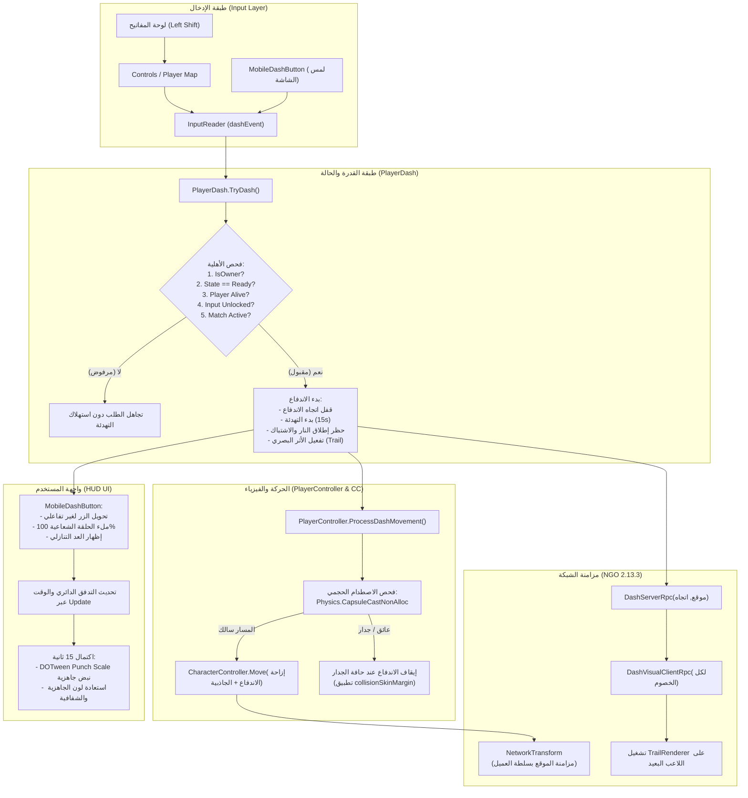

# دليل إعداد وتشغيل نظام الاندفاع الجماعي (Multiplayer Dash Ability)
**Unity 6.3 | Unity Netcode for GameObjects (NGO) 2.13.3 | Unity Input System | DOTween Pro**

---

## 1. نظرة عامة على البنية البرمجية (Architecture Overview)

تم بناء نظام الاندفاع (Dash Ability) ليكون متوافقاً 100% مع البنية الحركية القائمة في المشروع والمعتمدة على **حركة اللاعب الموثوقة من العميل (Client-Authoritative Movement)**، دون تحويل سلطة الحركة إلى الخادم ودون إحداث أي تعارض مع حركة `CharacterController` الأساسية أو مزامنة `NetworkTransform`.

### المبادئ الهندسية الأساسية:
1. **نقطة تفعيل مركزية مشتركة (Unified Activation Pathway):**
   - يعمل كل من زر لوحة المفاتيح (`Left Shift` على الحاسوب) وزر الشاشة اللمسية المخصص (`MobileDashButton` على الجوال) عبر نفس مسار الإدخال في `InputReader` (`dashEvent`).
   - يتشارك كلا النظامين **فترة تهدئة واحدة مركزية مدتها 15 ثانية (Single Shared 15-Second Cooldown)**.
2. **تحديد الاتجاه الذكي (Direction Selection Rules):**
   - **أثناء الحركة:** يندفع اللاعب في اتجاه حركته الفعلي الحالي في الفضاء العالمي (Camera-relative World Direction).
   - **أثناء الوقوف الثابت:** يندفع اللاعب في آخر اتجاه حركة صالح تم تسجيله (`_lastValidMoveDirection`).
   - **الاحتياطي الآمن (Fallback):** في حال عدم وجود أي حركة سابقة، يتم الاندفاع في اتجاه نظر اللاعب الحالي (`transform.forward`).
3. **أمان تام ضد اختراق الجدران (Collision Safety - Zero Wall Penetration):**
   - يتم احتساب كل خطوة إزاحة للاندفاع مسبقاً عبر فحص حجمي مجوف (`Physics.CapsuleCastNonAlloc`) يطابق أبعاد ومحيط `CharacterController` للاعب، مع تطبيق هامش أمان سطحي (`collisionSkinMargin = 0.05m`).
   - في حال رصد جدار أو عائق صلب، تتوقف الحركة وتنهي الاندفاع فوراً عند سطح العائق دون حدوث أي اختراق أو انتقال مفاجئ (Teleport).
4. **حظر القتال أثناء الاندفاع (Combat Restrictions During Dash):**
   - يتم حظر إطلاق النار الأساسي (`PlayerShooting.TryFire`) وإطلاق الجوال (`RequestMobileFire`) ومعاينة الليزر (`HideAimPreview`) وهجوم القتال اليدوي (`PlayerMelee.TryMelee`) طوال فترة تنفيذ الاندفاع.
5. **مؤشر واجهة مستخدم دائري (Circular Radial Cooldown UI):**
   - زر لمسي مخصص مجاور تماماً لزر الاشتباك اليدوي (`MeleeButton`) مزود بـ `Image.Type = Filled` (Radial 360)، نص عد تنازلي للثواني، وتأثير نبض حركي عند الجاهزية باستخدام `DOTween Pro`.
6. **شريط أثر بصري متزامن شبكياً (Networked Visual Trail):**
   - يتم تفعيل `TrailRenderer` محلياً للرامي على الفور للاستجابة الصفرية، وإرسال `DashServerRpc` -> `DashVisualClientRpc` لتفعيل الأثر على النسخ المماثلة لدى الخصوم دون إنشاء GameObjects جديدة على الشبكة لكل إطار.



---

## 2. الملفات البرمجية المنشأة والمعدلة (Scripts Inventory)

| اسم السكريبت | المسار في المشروع | النوع | المسؤولية والوظيفة الرئيسية |
|---|---|---|---|
| **`PlayerDash.cs`** | `Assets/_Multiplayer/Players/Scripts/PlayerDash.cs` | **جديد** | المكون المركزي للقدرة: إدارة الحالات (`Ready`, `Dashing`, `Cooldown`)، التهدئة المشتركة (15 ثانية)، احتساب الاصطدام المجوف الحجمي، والتحكم في الأثر الشبكي والـ RPCs. |
| **`MobileDashButton.cs`** | `Assets/_Multiplayer/Inputs/Scripts/Mobile/MobileDashButton.cs` | **جديد** | زر الجوال اللمسي: عزل لمس الإصبع (`PointerId`)، إدارة تدفق الحلقة الشعاعية (`Image.Type = Filled`)، عد تنازلي بالثواني، وتأثيرات `DOTween`. |
| **`DashAbilitySetupEditor.cs`** | `Assets/_Multiplayer/Scripts/Lobby/Editor/DashAbilitySetupEditor.cs` | **جديد** | أداة محرر برمجية لتجهيز الـ Prefabs والمشهد آلياً عبر قوائم يونيتي أو عند بدء التشغيل بدون تدخل يدوي. |
| **`InputReader.cs`** | `Assets/_Multiplayer/Inputs/Scripts/InputReader.cs` | **معدل** | إضافة حدث `dashEvent`، وتنفيذ `OnDash(CallbackContext)` وتوفير مدخل الجوال `TriggerDash()`. |
| **`Controls.cs`** | `Assets/_Multiplayer/Inputs/Scripts/Controls.cs` | **معدل** | تحديث كود التحكم المولد وإضافة Action الاندفاع `Dash` مع ربط `Left Shift` وGamepad Button East، وتحديث واجهة `IPlayerActions`. |
| **`InputSystem_Actions.inputactions`** | `Assets/_Multiplayer/Inputs/InputSystem_Actions.inputactions` | **معدل** | إضافة إجراء `Dash` وربطه بلوحة المفاتيح ومقابض التحكم في ملف الأصول الفعلي. |
| **`PlayerController.cs`** | `Assets/_Multiplayer/Players/Scripts/PlayerController.cs` | **معدل** | تتبع آخر اتجاه حركة صالح بدقة (`_lastValidMoveDirection`)، توفير `GetDashDirection()`، وتشغيل `ProcessDashMovement()` بدون تعارض. |
| **`PlayerShooting.cs`** | `Assets/_Multiplayer/Players/Scripts/Combat/PlayerShooting.cs` | **معدل** | حظر إطلاق النار، تعطيل إطلاق الجوال عند الاندفاع، وإخفاء شعاع المعاينة الليزري فوراً عند بدء الاندفاع. |
| **`PlayerMelee.cs`** | `Assets/_Multiplayer/Players/Scripts/Combat/PlayerMelee.cs` | **معدل** | حظر تنفيذ هجمات الاشتباك اليدوي أثناء فترة الاندفاع. |
| **`MobileControlsHUD.cs`** | `Assets/_Multiplayer/Inputs/Scripts/Mobile/MobileControlsHUD.cs` | **معدل** | إضافة مرجع `MobileDashButton` وربط دورة حياة اللاعب ومسح الإدخال عند الموت وإعادة الإحياء. |
| **`MobileControlsSetupEditor.cs`** | `Assets/_Multiplayer/Inputs/Scripts/Mobile/Editor/MobileControlsSetupEditor.cs` | **معدل** | تحديث أداة بناء الـ HUD لإنشاء زر الاندفاع وحلقته الشعاعية تلقائياً بجوار زر الاشتباك اليدوي. |
| **`Player.prefab`** | `Assets/_Multiplayer/Players/Prefabs/Player.prefab` | **معدل** | تزويد اللاعب بمكون `PlayerDash` وكائن فرعي `DashTrail` يحمل `TrailRenderer`. |
| **`MobileControlsHUD.prefab`** | `Assets/_Multiplayer/Prefabs/MobileControlsHUD.prefab` | **معدل** | دمج كائن `DashButton` داخل `CombatControls` بجانب `MeleeButton`. |

---

## 3. إعداد نظام الإدخال (Unity Input System)

### إجراء الاندفاع (Dash Input Action):
1. **الاسم:** `Dash` داخل Action Map: `Player`.
2. **النوع:** `Button` مع تفعيل عند الضغط لمرة واحدة (`performed` phase).
3. **الربط الافتراضي للحاسوب (PC Binding):**
   - مسار الزر: `<Keyboard>/leftShift`
   - المجموعة: `Keyboard&Mouse`
4. **الربط لمقابض التحكم (Gamepad Binding):**
   - مسار الزر: `<Gamepad>/buttonEast` (زر B في Xbox / الدائرة في PlayStation).

### التعديل في `InputReader`:
```csharp
// الحدث العام
public event Action dashEvent;

// استجابة الحدث من Input System
public void OnDash(InputAction.CallbackContext context)
{
    if (context.performed)
    {
        dashEvent?.Invoke();
    }
}

// استدعاء من واجهة الجوال
public void TriggerDash()
{
    dashEvent?.Invoke();
}
```

---

## 4. احتساب وتحديد اتجاه الاندفاع (Direction Calculation)

تتبع الخوارزمية القواعد الدقيقة التالية:

```csharp
public Vector3 GetDashDirection()
{
    // الحالة أ: اللاعب يتحرك حالياً
    if (CurrentMoveDirection.sqrMagnitude > 0.001f)
    {
        return CurrentMoveDirection;
    }

    // الحالة ب: اللاعب متوقف وثابت
    if (_lastValidMoveDirection.sqrMagnitude > 0.001f)
    {
        return _lastValidMoveDirection;
    }

    // الحالة الاحتياطية: قبل حدوث أي حركة منذ البداية
    Vector3 fwd = transform.forward;
    fwd.y = 0f;
    if (fwd.sqrMagnitude > 0.001f)
    {
        return fwd.normalized;
    }

    return Vector3.forward;
}
```

### آلية تخزين آخر اتجاه صالح:
- في دالة `PlayerController.ProcessMovement()`:
  يتم احتساب اتجاه الحركة المسقط في المستوى الأفقي بالنسبة للكاميرا:
  ```csharp
  Vector3 moveDirection = new Vector3(currentMoveInput.x, 0f, currentMoveInput.y);
  moveDirection = mainCamera.transform.TransformDirection(moveDirection);
  moveDirection.y = 0f;
  moveDirection.Normalize();

  if (moveDirection.sqrMagnitude > 0.001f)
  {
      CurrentMoveDirection = moveDirection;
      _lastValidMoveDirection = moveDirection; // يتم التحديث باستمرار أثناء الحركة
  }
  else
  {
      CurrentMoveDirection = Vector3.zero; // لا يتم مسح _lastValidMoveDirection بل يبقى محفوظاً
  }
  ```
- **قفل الاتجاه:** فور قبول الاندفاع في `PlayerDash.StartDash(direction)`، يتم تخزين الاتجاه في `lockedDashDirection` ولا يمكن لأي حركة إضافية من عصا التحكم أو لوحة المفاتيح تغيير مسار الاندفاع حتى ينتهي.

---

## 5. الحماية والأمان ضد اختراق الجدران (Collision Safety)

تعتمد الحماية على فحص هندسي مسبق قبل تحريك كل إطار باستخدام `Physics.CapsuleCastNonAlloc`:

```csharp
public bool ExecuteDashStep(CharacterController cc, float dt, out Vector3 horizontalDisplacement, out bool hitObstacle)
{
    horizontalDisplacement = Vector3.zero;
    hitObstacle = false;

    if (CurrentState != DashState.Dashing) return false;

    float dashSpeed = dashDistance / dashDuration; // 4m / 0.25s = 16 m/s
    float desiredDistance = dashSpeed * dt;

    // احتساب نقاط الكبسولة المطابقة لشكل الـ CharacterController
    Vector3 centerWorld = transform.position + cc.center;
    float halfHeight = Mathf.Max(0f, (cc.height * 0.5f) - cc.radius);
    Vector3 point1 = centerWorld + Vector3.up * halfHeight;
    Vector3 point2 = centerWorld - Vector3.up * halfHeight;

    // استخدام نصف قطر محكم قليلاً لتفادي الاحتكاك بالأسطح الموازية
    float sweepRadius = Mathf.Max(0.05f, cc.radius - collisionSkinMargin);

    int hitCount = Physics.CapsuleCastNonAlloc(
        point1,
        point2,
        sweepRadius,
        lockedDashDirection,
        sweepHits,
        desiredDistance + collisionSkinMargin,
        collisionLayers,
        QueryTriggerInteraction.Ignore
    );

    float safeDistance = desiredDistance;

    for (int i = 0; i < hitCount; i++)
    {
        RaycastHit hit = sweepHits[i];
        if (hit.collider == null || hit.collider.transform.root == transform.root) continue;
        if (hit.collider.isTrigger) continue;

        float distanceToWall = Mathf.Max(0f, hit.distance - collisionSkinMargin);
        if (distanceToWall < safeDistance)
        {
            safeDistance = distanceToWall;
            hitObstacle = true;
        }
    }

    horizontalDisplacement = lockedDashDirection * safeDistance;
    ...
}
```

### معالجة الاصطدام:
- إذا كانت المسافة المتاحة أقل من خطوة الإطار، يتم تقليص الإزاحة لتصل إلى سطح الجدار مع ترك `collisionSkinMargin = 0.05m`.
- يتم إشعار النظام عبر `OnDashObstacleEncountered()` لإنهاء حركة الاندفاع مبكراً، واستئناف الحركة الطبيعية بسلاسة دون اهتزاز أو انتقال خاطئ.

---

## 6. واجهة مستخدم الاندفاع وتصور التهدئة (Cooldown UI)

### موضع الزر (Button Layout):
تم وضع زر `DashButton` داخل مجموعة `CombatControls` بجانب زر الاشتباك اليدوي `MeleeButton`:
- **MeleeButton:** `AnchoredPosition = (-180, 375)` | الحجم: `125x125`
- **DashButton:** `AnchoredPosition = (-315, 375)` | الحجم: `125x125`

يقع الزر في موضع مريح جداً لإبهام اليد اليمنى، على نفس الارتفاع الأفقي مع زر الاشتباك اليدوي، وفوق عصا التوجيه والإطلاق (`AimFireJoystick`) بمسافة كافية تمنع التداخل اللمسي تماماً.

### شجرة الكائنات في الواجهة (UI Hierarchy):
```text
MobileControlsHUD (Canvas / CanvasGroup)
└── SafeAreaRoot
    ├── MovementJoystick (عصا الحركة اليسرى)
    └── CombatControls (مجموعة أزرار القتال اليمنى)
        ├── AimFireJoystick (عصا التصويب والإطلاق مع الإفراج)
        ├── MeleeButton (زر الهجوم اليدوي البرتقالي)
        └── DashButton (زر الاندفاع الأزرق السماوي)
            ├── CooldownRadialFill (صورة الملء الشعاعي العكسي Radial 360)
            ├── DashIcon (أيقونة الركض Icon_Run)
            └── CooldownText (نص العد التنازلي بالثواني TMP)
```

### مواصفات مؤشر التهدئة الدائري (Radial Indicator):
1. **نوع الصورة:** `Image.Type = Filled`
2. **طريقة الملء:** `Fill Method = Radial 360`
3. **نقطة البداية واتجاه الدوران:** `Fill Origin = Top (2)` و `Fill Clockwise = false`.
4. **نسبة الامتلاء:**
   - عند الجاهزية: `fillAmount = 0f` والزر بلون أزرق سماوي نشط (`#1FB3F2`).
   - عند الاندفاع والتهدئة: تبدأ القيمة من `1f` وتتناقص تدريجياً بالتزامن المباشر مع `RemainingCooldown / DashCooldownDuration`.
5. **نص التهدئة:**
   - يظهر النص التنازلي التلقائي (مثل: `14.8`, `9.2`, `3.1`).
   - يختفي تلقائياً فور اكتمال التهدئة لتجنب حجب الأيقونة.
6. **أنيميشن DOTween:**
   - **عند الضغط:** يتم تطبيق `DOPunchScale(0.15, 0.15s)`.
   - **عند اكتمال الـ 15 ثانية:** يتم إطلاق نبض تنبيه بالجاهزية `DOPunchScale(0.12, 0.25s)` ليعلم اللاعب فوراً بإمكانية استخدامه مرة أخرى.

---

## 7. الأثر البصري المتزامن شبكياً (Networked Dash Trail)

- يحمل كل لاعب في مشهد اللعبة كائناً فرعياً `DashTrail` مزوداً بـ `TrailRenderer`.
- **مواصفات الأثر:**
  - `Time = 0.35s`
  - `Start Width = 0.65m`
  - `End Width = 0.05m`
  - لون متدرج نيون سماوي إلى أزرق داكن مع تلاشي الشفافية (`Alpha: 0.85 -> 0.0`).
- **المزامنة الشبكية:**
  1. يقوم اللاعب صاحب الشخصية (`IsOwner`) بتفعيل الاندفاع محلياً فوراً بدون تأخير، ثم يرسل `DashServerRpc`.
  2. يقوم الخادم بالتحقق من صحة التوقيت والحالة، ثم يرسل `DashVisualClientRpc`.
  3. يتلقى الخصوم الـ RPC ويتم تفعيل `TrailRenderer.emitting = true` محلياً لديهم على نسخة اللاعب المتحرك لمدة `dashDuration`، مما يعرض خط السرعة خلف الخصم المتزامن عبر `NetworkTransform` دون توليد كائنات شبكية مستمرة.

---

## 8. حظر القتال وإلغاء الاستعداد الخاطئ (Combat Blocking)

أثناء الاندفاع الفعلي (0.25 ثانية):
1. **في `PlayerShooting`:**
   - يتم رفض أي محاولة إطلاق نار (`TryFire`).
   - يتم حظر دالة إطلاق الجوال (`RequestMobileFire`).
   - يتم إخفاء شعاع المعاينة الليزري (`HideAimPreview(true)`).
   - يتم مسح حالة التأهب لعصا التوجيه (`SetMobileAim(Vector3.zero, false, false)`) لمنع إطلاق رصاصة غير مقصودة في نهاية الاندفاع.
2. **في `PlayerMelee`:**
   - يتم رفض طلبات الهجوم اليدوي دون استهلاك فترة تهدئة السلاح الأبيض.
3. **بعد نهاية الاندفاع:**
   - تعود صلاحية القتال فوراً للاعب الحي المؤهل دون الحاجة لإعادة تشغيل أي مدخلات.

---

## 9. دليل إعداد المحرر خطوة بخطوة (Inspector Setup Guide)

إذا أردت فحص أو ضبط المكونات يدوياً في محرر يونيتي:

### أولاً: أصل `Player.prefab`
المسار: `Assets/_Multiplayer/Players/Prefabs/Player.prefab`
1. تأكد من وجود مكون **`PlayerDash`**:
   - `Input Reader`: قم بسحب `Assets/_Multiplayer/Inputs/SO/InputReader.asset`.
   - `Dash Cooldown`: `15` ثانية.
   - `Dash Duration`: `0.25` ثانية.
   - `Dash Distance`: `4` أمتار.
   - `Collision Skin Margin`: `0.05`.
   - `Collision Layers`: `Everything` ما عدا طبقة اللاعب (16) وطبقة UI وطبقة IgnoreRaycast.
   - `Trail Renderer`: اسحب كائن `DashTrail` الموجود في كائنات اللاعب الفرعية.
   - `Trail Fade Duration`: `0.35`.

### ثانياً: أصل `MobileControlsHUD.prefab`
المسار: `Assets/_Multiplayer/Prefabs/MobileControlsHUD.prefab`
1. تأكد من وجود كائن **`DashButton`** تحت `SafeAreaRoot -> CombatControls`.
2. مكون **`MobileDashButton`**:
   - `Input Reader`: مسند إلى `InputReader.asset`.
   - `Button Rect`: مسند إلى `RectTransform` الخاص بـ `DashButton`.
   - `Button Background`: مسند إلى مكون `Image` الرئيسي.
   - `Cooldown Radial Fill`: مسند إلى `Image` الخاص بـ `CooldownRadialFill`.
   - `Dash Icon`: مسند إلى `Image` الخاص بـ `DashIcon`.
   - `Cooldown Text`: مسند إلى `TextMeshProUGUI` الخاص بـ `CooldownText`.
3. مكون **`MobileControlsHUD`** في جذر الـ Prefab:
   - حقل `Dash Button`: مسند إلى `DashButton`.

### ثالثاً: التشغيل التلقائي عبر القائمة
يمكنك في أي وقت إعادة بناء الـ Prefabs والمشهد بالكامل بضغطة زر واحدة:
- اذهب إلى شريط القوائم العلوي في يونيتي:
  **`Tools -> Multiplayer -> Complete Dash Ability Setup`**
  أو:
  **`Tools -> Mobile Controls -> Build Mobile Controls Prefab & Setup Scene`**

---

## 10. قائمة التحقق والاختبار (Testing Checklist)

| رقم | الاختبار | النتيجة المتوقعة |
|:---:|---|---|
| **1** | **الاندفاع أثناء الحركة للأمام** | يندفع اللاعب للأمام في نفس اتجاه الكاميرا والحركة لمسافة 4 أمتار خلال 0.25 ثانية. |
| **2** | **الاندفاع الجانبي والخلفي** | يندفع اللاعب في الاتجاه الجانبي أو الخلفي الفعلي المضغوط وليس اتجاه تصويب الماوس. |
| **3** | **الاندفاع أثناء الوقوف الثابت** | عند تحريك اللاعب لليمين ثم التوقف التام والضغط على الاندفاع، يندفع اللاعب لليمين (آخر اتجاه صالح). |
| **4** | **الاندفاع قبل حدوث أي حركة** | عند بدء اللعبة دون لمس أي زر حركة، يندفع اللاعب للأمام (`transform.forward`). |
| **5** | **الاصطدام بجدار أمامي** | يتوقف الاندفاع عند جدار الغرفة أو العائق على مسافة 0.05m ولا يخترق الجدار نهائياً. |
| **6** | **الاصطدام بالزوايا والممرات الضيقة** | ينزلق اللاعب أو يقف عند الزاوية دون حدوث أي ارتداد عنيف أو انتقال مفاجئ. |
| **7** | **تزامن التهدئة بين الحاسوب والجوال** | الضغط على `Left Shift` يجعل زر الجوال يبدأ دورة الـ 15 ثانية، والضغط على زر الجوال يمنع زر `Left Shift` من إعادة الاندفاع. |
| **8** | **المؤشر الشعاعي والعد التنازلي** | تتناقص الحلقة الدائرية تدريجياً بالتزامن مع الثواني، وينبض الزر (Pulse) فور اكتمال التهدئة. |
| **9** | **منع إطلاق النار أثناء الاندفاع** | الضغط على زر إطلاق النار أو إفلات عصا التصويب أثناء الاندفاع لا يطلق أي مقذوف ولا يسترجع ذخيرة. |
| **10** | **منع الاشتباك اليدوي أثناء الاندفاع** | الضغط على زر المسطرة (Space) أو زر Melee اللمسي أثناء الاندفاع لا ينفذ هجوم القتال اليدوي. |
| **11** | **رؤية الأثر البصري لدى الخصوم** | عند تشغيل خادم وعميلين، يرى كل عميل شريط السرعة النيون خلف اللاعب المندفع. |
| **12** | **الموت وإعادة الإحياء أثناء التهدئة** | عند موت اللاعب أثناء سريان الـ 15 ثانية، لا تُعاد التهدئة إلى الصفر، بل تستمر حتى تكتمل مدتها المتبقية. |
| **13** | **العودة إلى الردهة وبدء مباراة جديدة** | لا تتبقى أي حالات اندفاع أو دورات Cooldown عالقة عند تفريغ المشهد والبدء من جديد. |

---

## 11. استكشاف الأخطاء وحلولها (Troubleshooting)

### س: الاندفاع لا يبدأ عند الضغط على `Left Shift`؟
- **السبب 1:** تأكد من أن حالة المباراة هي `MatchState.Active` (لا يمكن الاندفاع أثناء العد التنازلي للبداية).
- **السبب 2:** تأكد من عدم تعارض أصل `InputReader` في `PlayerController`؛ يجب أن يكون مسنداً إلى `Assets/_Multiplayer/Inputs/SO/InputReader.asset`.
- **السبب 3:** تأكد من عدم وجود نافذة أخرى في نظام التشغيل تسحب التركيز من نافذة اللعبة.

### س: اللاعب يندفع في اتجاه عشوائي عند التوقف؟
- **الحل:** يقوم `PlayerController` بتسجيل آخر اتجاه حركة في `_lastValidMoveDirection`. إذا كان اللاعب لم يتحرك بعد، يُستخدم `transform.forward`. تأكد من أن تدوير اللاعب يحدد `transform.forward` بشكل سليم.

### س: اللاعب يقترب من الجدار ويتوقف قبل المسافة الكاملة؟
- **هذا سلوك مقصود تماماً:** نظام الحماية الحجمي يمنع اختراق الجدران؛ إذا كان الجدار يبعد متراً واحداً فقط، ستقطع القدرة متراً واحداً فقط وتقف بأمان عند الحافة.

### س: حلقة التهدئة لا تدور في زر الجوال؟
- **الحل:** تأكد من أن كائن `CooldownRadialFill` يحمل نوع صورة `Image.Type = Filled` مع `Fill Method = Radial 360` و `Fill Clockwise = false`. سكريبت `MobileDashButton.EnsureRadialFillConfiguration()` يقوم بضبطها برمجياً تلقائياً في `Awake`.

### س: أزرار الجوال ظاهرة أثناء اللعب على الحاسوب؟
- **الحل:** في مكون `MobileControlsHUD`، خيار `Platform Mode` الافتراضي هو `Auto`، وخيار `Force Mobile In Editor` مفعّل لأغراض الاختبار في المحرر فقط. عند عمل Build للحاسوب ستختفي الواجهة تلقائياً وتظهر فقط على أجهزة Android و iOS.
