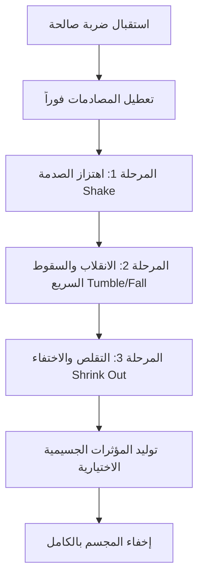

# دليل الصناديق القابلة للتدمير للعب الجماعي (Multiplayer Destructible Crates Guide)
## Unity 6.3 / Netcode for GameObjects (NGO 2.13.3) / DOTween Pro

---

## 1. فهرس الصناديق المستهدفة في المشروع (Target Crate Inventory)

تم إجراء مسح شامل لكافة أصول ومشاهد المشروع للبحث عن الصناديق التي تطابق أو تحتوي على الاسم:
`SM_PolygonPrototype_Prop_Crate_03` (بما في ذلك اللواحق الرقمية المتنوعة).

### أ) الخرائط الجماعية الأربعة ومحتوياتها من الصناديق:

1. **الخريطة الأولى (`PVP Map 1.prefab`)**:
   - **عدد الصناديق**: **64 صندوقاً**.
   - **النوع**: نُسخ بريفاب (`Prefab Instances`) مشتقة من `Assets/Environment/SM_PolygonPrototype_Prop_Crate_03 (3).prefab`.
   - **المكونات المرتبطة**: تحتوي كل نسخة على مصادم `MeshCollider (Convex)`، ومكون `DestructibleBox`، ومجسم `MeshRenderer`.
   - **الطبقة (Layer)**: Layer 13 (`Box`).

2. **الخريطة الثانية (`PVP Map 2.prefab`)**:
   - **عدد الصناديق**: **62 صندوقاً**.
   - **النوع**: نُسخ بريفاب (`Prefab Instances`) مشتقة من `Assets/Environment/SM_PolygonPrototype_Prop_Crate_03 (3).prefab`.
   - **المكونات المرتبطة**: مصادم `MeshCollider (Convex)`، ومكون `DestructibleBox`، ومجسم `MeshRenderer`.
   - **الطبقة (Layer)**: Layer 13 (`Box`).

3. **الخريطة الثالثة (`PVP Map 3.prefab`)**:
   - **عدد الصناديق**: **44 صندوقاً**.
   - **النوع**: نُسخ بريفاب (`Prefab Instances`) مشتقة من `Assets/Environment/SM_PolygonPrototype_Prop_Crate_03 (3).prefab`.
   - **المكونات المرتبطة**: مصادم `MeshCollider (Convex)`، ومكون `DestructibleBox`، ومجسم `MeshRenderer`.
   - **الطبقة (Layer)**: Layer 13 (`Box`).

4. **الخريطة الرابعة (`PVP Map 4.prefab`)**:
   - **عدد الصناديق**: **36 صندوقاً**.
   - **النوع**: كائنات مشهدية مستقلة مباشرة داخل البريفاب بأسماء تبدأ بـ `SM_PolygonPrototype_Prop_Crate_03 (18)` حتى `(68)` (مثال: `SM_PolygonPrototype_Prop_Crate_03 (22)`).
   - **المكونات المرتبطة**: مصادم `MeshCollider (Convex)`، ومكون `DestructibleBox`، ومجسم `MeshRenderer`.
   - **الطبقة (Layer)**: Layer 13 (`Box`).

- **إجمالي الصناديق المستهدفة في الخرائط الأربعة**: **206 صناديق**.
- **مشهد `MainMultiplayer.unity`**: لا يحتوي على صناديق بيئية ثابتة مسبقاً، بل يتم توليد الخريطة المحددة (1 أو 2 أو 3 أو 4) ديناميكياً عند بدء المباراة عبر `MatchManager`.

---

## 2. بنية العزل التام عن اللعب الفردي (Multiplayer-Only Isolation)

لحماية نظام الطور الفردي (`Single-Player`) ومشاهده من أي تأثير أو خلل:

1. **حماية الأصول ثلاثية الأبعاد المشتركة (`SyntyStudios PolygonStarter`)**:
   - مجسم `SM_PolygonPrototype_Prop_Crate_03.fbx` ونسخته الأصلية في `SyntyStudios/PolygonStarter/Prefabs/SM_PolygonPrototype_Prop_Crate_03.prefab` لم يتم التعديل عليها نهائياً ولم تُضف إليها أي مكونات شبكية.
   - خامات المجسم المشتركة (`PolygonStarter_Mat_01`) لم يتم المساس بها أو تحويلها لخامات شفافة حتى لا تتأثر مشاهد اللعب الفردي.
2. **عزل المكونات البرمجية**:
   - تم بناء مكون `DestructibleBox.cs` حصرياً داخل مجلد اللعب الجماعي: `Assets/_Multiplayer/Scripts/Box/DestructibleBox.cs`.
   - لا يوجد أي مشهد فردي (مثل `Assets/Scenes/Main.unity`) يستخدم مكون `DestructibleBox`.
3. **توليد الخرائط وإدارتها**:
   - خرائط اللعب الجماعي الأربعة متواجدة داخل `Assets/_Multiplayer/Levels/PVP Levels/`، وتُدار بالكامل عبر `MatchManager.cs` الخاص بنظام الأونلاين فقط.

---

## 3. المكونات والمسؤوليات (Components & Responsibilities)

### أ) المكون `DestructibleBox.cs`:
- **الموقع**: `Assets/_Multiplayer/Scripts/Box/DestructibleBox.cs`.
- **النوع**: `MonoBehaviour` يطبق واجهة الأضرار الشاملة `INetworkDamageable`.
- **المسؤولية**:
  1. تمثيل الصندوق كهدف فيزيائي قابل للأضرار بضربة واحدة (`One-Hit Destruction`).
  2. استقبال وتوجيه ضربات الأسلحة والضربات القريبة إلى مدير المباراة `MatchManager` على السيرفر.
  3. تعطيل المصادمات (`Colliders`) فوراً على جميع الأجهزة عند قبول التدمير لمنع اختراق الأشعة أو تكرار الضربات.
  4. تشغيل حركات تدمير ثلاثية المراحل باستخدام **DOTween Pro**.
  5. دعم الاستعادة الكاملة (`ResetCrate`) ومزامنة اللاعبين المتأخرين (`ApplyImmediateDestroyedState`).

### ب) المكونات على كائن الصندوق نفسه:
- **`Transform`**: الموضع والدوران والمقياس الأولي للصندوق في الخريطة.
- **`MeshFilter`**: يحمل شبكة المجسم `SM_PolygonPrototype_Prop_Crate_03`.
- **`MeshRenderer`**: يعرض الصندوق.
- **`MeshCollider` (`Convex: true`)**: يوفر التصادم الفيزيائي المباشر مع أشعة المقذوفات (`Hitscan Raycast`) وهجمات الاشتباك القريب (`Melee OverlapSphere`).
- **`DestructibleBox`**: الكود المسؤول عن استلام الضربة وإطلاق حركات التدمير.

---

## 4. تكامل نظام إطلاق النار (Firearm Hitscan Integration)

في ملف `PlayerShooting.cs` داخل دالة محاكاة المقذوفات الموثوقة `SimulateTrajectory`:

```csharp
else if (damageable != null && hit.collider.transform.root != transform.root)
{
    // Hit a destructible object!
    if (serverFiredType.HasValue && IsServer)
    {
        float damage = CalculateDistanceDamage(cumulativeDistance);
        if (damageable is DestructibleBox destructibleBox)
        {
            destructibleBox.TakeDamageWithHitInfo(damage, OwnerClientId, hit.point, currentDir);
        }
        else
        {
            damageable.TakeDamage(damage, OwnerClientId);
        }
    }

    // Stop ray immediately: do not penetrate or bounce off destructibles
    break;
}
```

### القواعد الصارمة المطبقة:
1. **إيقاف مسار الشعاع فوراً (`break`)**:
   - الشعاع يتوقف تماماً عند الصندوق ولا يخترقه ولا يرتد عنه حتى لو كانت الجدران المجاورة تسمح بالارتداد (`Ricochet`).
2. **عدم معاملة الصندوق كلاعب**:
   - لا تُحتسب أي إحصائيات قتلى أو أضرار لاعبين ضد الصندوق.
3. **منع استرداد الذخيرة (`No Ammo Refund`)**:
   - استرداد الذخيرة الأساسية مقتصر حصراً على إصابة لاعب خصم (`hitEnemyPlayer = true`). عند إصابة الصندوق يظل `wasRefunded = false`.
4. **حماية ليزر المعاينة (`Aim Preview`)**:
   - أثناء التصويب، تكون قيمة `serverFiredType` فارغة (`null`)، وبالتالي لا يُنفّذ سطر إلحاق الضرر نهائياً أثناء المعاينة. الضرر يحدث حصراً على السيرفر في أمر `FireServerRpc`.
5. **الطلقات المرتدة**:
   - إذا ارتدت الطلقة عن جدار مرتد ثم أصابت صندوقاً، فإنها تدمره على الفور وتتوقف مسارها عند الصندوق.

---

## 5. تكامل الضربات القريبة (Melee Integration)

في ملف `PlayerMelee.cs` داخل دالة التنفيذ على السيرفر `ExecuteMeleeServer`:

```csharp
// Find all colliders in range (ensure Box layer is included)
int boxLayer = LayerMask.NameToLayer("Box");
LayerMask combinedMask = meleeData.hitLayers;
if (boxLayer != -1)
{
    combinedMask |= (1 << boxLayer);
}

Collider[] hits = Physics.OverlapSphere(
    attackerPosition,
    meleeData.attackRange,
    combinedMask
);
```

ثم داخل حلقة فحص المصادمات المصابة:

```csharp
INetworkDamageable damageable = col.GetComponentInParent<INetworkDamageable>();
if (damageable == null) continue;

if (damageable is DestructibleBox destructibleBox)
{
    destructibleBox.TakeDamageWithHitInfo(meleeData.damage, OwnerClientId, col.bounds.center, attackerForward);
}
else
{
    damageable.TakeDamage(meleeData.damage, OwnerClientId);
}
```

### القواعد الصارمة المطبقة:
1. **تضمين طبقة الصناديق (`Layer 13: Box`)**:
   - تم تحديث أصل البيانات `Assets/_Multiplayer/Players/SO/MainMeleeData.asset` وضبط قناع الطبقات `hitLayers` ليشمل طبقة الصناديق واللاعبين معاً، مع إضافة فحص ديناميكي في الكود لضمان الإصابة حتى لو لم يتم تعديل الأصل يدوياً.
2. **المسار التدميري الموحد**:
   - تستدعي الضربة القريبة نفس دالة `TakeDamageWithHitInfo` الموثوقة المزودة باتجاه ضربة اللاعب وموضعها.
3. **الحماية من تعدد التدمير في الضربة الواحدة**:
   - يتم حماية العملية بواسطة المتغير `_isDestroyedAuthoritative` في الصندوق، بحيث إذا لامس مصادم اللاعب أكثر من جزء من الصندوق في إطار واحد، تُقبل الضربة الأولى فقط وتُهمل البقية فوراً.

---

## 6. إعدادات الحركة والتدمير بواسطة DOTween Pro

تتميز حركة التدمير بثلاث مراحل متتالية وسلسة بزمن إجمالي يقارب **0.85 ثانية**:



### تفاصيل المراحل وقيمها في الـ Inspector:

1. **المرحلة 1: اهتزاز الصدمة (Impact Shake)**:
   - **`shakeDuration`** = `0.18f` ثانية.
   - **`shakeStrength`** = `0.2f`.
   - **`shakeVibrato`** = `12`.
   - يُعطي شعوراً فورياً بقوة المقذوف أو الضربة عبر اهتزاز الموضع والزوايا في وقت واحد دون تحريك المصادم الفيزيائي (لأنه تم تعطيله بالفعل).

2. **المرحلة 2: الانقلاب والسقوط (Falling / Rapid Tumble)**:
   - **`fallingDuration`** = `0.45f` ثانية.
   - **`rotationAngle`** = `45f` درجة.
   - **`fallingDisplacement`** = `0.25f` متر نحو الأسفل.
   - إذا تم تفعيل `useHitDirection = true`، يميل الصندوق ويسقط في الاتجاه الطبيعي المعاكس لاتجاه القدوم، مما يضفي ديناميكية واقعية جداً.

3. **المرحلة 3: التقلص والاختفاء (Shrink Out & Disappear)**:
   - **`shrinkDuration`** = `0.35f` ثانية.
   - **`shrinkEase`** = `Ease.InBack` (تقلص ديناميكي ينكمش إلى الصفر).
   - يتم توليد جزيئات التدمير `destructionParticles` (إن وُجدت) في موقع الصندوق فور اكتمال التلاشي، ثم يُعطل `MeshRenderer`.

4. **إدارة الأمان ونظافة الذاكرة (Tween Safety)**:
   - يُستدعى `DOKill(false)` عند التدمير، وعند التعطيل `OnDisable`، وعند الحذف `OnDestroy`، لمنع أي تسريب للذاكرة أو محاولة تحريك كائنات ملغاة عند تفريغ الخريطة.

---

## 7. المزامنة الشبكية وسلطة السيرفر (Multiplayer Synchronization)

1. **سلطة السيرفر المطلقة (Server-Authoritative)**:
   - لا يمكن للعميل (`Client`) اتخاذ قرار تدمير الصندوق محلياً بمفرده.
   - السيرفر هو الوحيد الذي يستقبل ضربة السلاح أو الاشتباك ويتحقق من حالة الصندوق (`!isDestroyed`) وحالة المباراة (`MatchState.Active`).
2. **منع التكرار والتضارب (Idempotency)**:
   - إذا أطلق لاعبان النار على نفس الصندوق في نفس الجزء من الثانية، تُسجل الضربة الأولى فقط وتتحول حالة الصندوق إلى مدمر `_isDestroyedAuthoritative = true`. الضربة الثانية يتم رفضها فوراً على السيرفر ولا تُرسل أي رسائل RPC مكررة.
3. **البث للعملاء (`NotifyCrateDestroyedClientRpc`)**:
   - يرسل مدير المباراة `MatchManager` استدعاء RPC واحداً خفيفاً يحمل:
     - `int crateIndex`: الفهرس المحدد للصندوق على الخريطة النشطة.
     - `Vector3 hitPoint`: نقطة الارتطام.
     - `Vector3 hitDirection`: اتجاه المقذوف أو الضربة.
   - يستقبل كل عميل (والمستضيف نفسه) هذا الأمر ويشغل المؤثر البصري محلياً عنده بتزامن تام.
4. **مزامنة اللاعبين المنضمين لاحقاً (`Late-Joiner Synchronization`)**:
   - يحتفظ `MatchManager` بقائمة الفهارس المدمرة `_destroyedCrateIndices`.
   - عند تحميل الخريطة، يطلب العميل حالة الصناديق عبر `RequestMapCrateStateServerRpc`، فيرد السيرفر بقائمة الصناديق المدمرة ليتم تطبيق حالة الإخفاء الفوري `ApplyImmediateDestroyedState` عليها دون إعادة تشغيل الحركات القديمة.

---

## 8. دورة حياة المباراة وعودة الصناديق في الجولة التالية (Match Lifecycle)

1. **البقاء في حالة تدمير طوال المباراة الحالية**:
   - الصندوق المدمر يظل مدمراً ومصادمه معطلاً طوال الجولة.
   - لا يعود الصندوق للحياة عند موت أي لاعب، ولا عند إعادة إحيائه (`Respawn`)، ولا عند ظهور شاشة النتائج.
2. **الاستعادة الحتمية في المباراة التالية**:
   - عند انتهاء المباراة والانتقال لمباراة جديدة (أو العودة للوبي):
     - يستدعي `MatchManager` دالة `UnloadActiveMap()` التي تحذف كائن الخريطة السابقة بالكامل `Destroy(_activeMapInstance)`.
     - يتم تصفير سجلات الصناديق المدمرة `_destroyedCrateIndices.Clear()`.
     - عند بدء الجولة واختيار خريطة جديدة (أو حتى نفس الخريطة)، يتم إنشاء نسخة جديدة تماماً ونظيفة من بريفاب الخريطة (`Instantiate`).
     - يتم استدعاء `RegisterActiveMapCrates(_activeMapInstance)` لترقيم وتهيئة الصناديق الجديدة بحالتها الأصلية الكاملة ومصادماتها النشطة.
3. **دعم إعادة التصفير الموضعي (`ResetAllActiveCrates`)**:
   - في حال إعادة تشغيل المباراة في نفس الخريطة دون تفريغها، تقوم دالة `ResetAllActiveCrates` باستعادة جميع الصناديق الأصلية وإعادة تفعيل المصادمات وإلغاء علامات التدمير.

---

## 9. الإعداد اليدوي في الـ Inspector (Manual Setup Guide)

النظام مبرمج ليعمل تلقائياً وبشكل ذاتي بنسبة 100% فور استدعاء الخرائط دون الحاجة لإعادة ربط يدوي للصناديق، لأن الـ 206 صناديق في الخرائط الأربعة تحتوي بالفعل على مكون `DestructibleBox`.

إذا أردت تخصيص المؤثرات أو ضبط أزمنة الحركة لأي صندوق أو بريفاب:

1. **لإضافة جزيئات التدمير (`Destruction Particles`)**:
   - حدد أي صندوق أو بريفاب الخريطة.
   - في مكون `DestructibleBox`:
     - اسحب بريفاب الجسيمات المرغوب (مثل `CFXR Explosion 1` أو أي بريفاب دخان/غبار) إلى حقل **`Destruction Particles`**.
2. **لتعديل أزمنة الحركة (Animation Timing)**:
   - **`Total Duration`**: الزمن الإجمالي التقريبي (الافتراضي: 0.85).
   - **`Shake Duration`**: مدة اهتزاز الصدمة (الافتراضي: 0.18).
   - **`Falling Duration`**: مدة الانقلاب السريع (الافتراضي: 0.45).
   - **`Shrink Duration`**: مدة التلاشي والتقلص (الافتراضي: 0.35).
   - **`Rotation Angle`**: زاوية ميل الصندوق (الافتراضي: 45).
3. **فحص الـ Layer**:
   - تأكد دائماً أن الصناديق مضبوطة على طبقة `Layer 13` المسماة **`Box`**.

---

## 10. قائمة التحقق والاختبار (Testing Checklist)

عند تجربة النظام في محرر Unity أو في بيئة متعددة اللاعبين:

- [ ] **اختبار إطلاق النار (Firearm Test)**:
  - أطلق رصاصة واحدة على الصندوق -> يجب أن يتدمر الصندوق فوراً بضربة واحدة.
  - تحقق من أن شعاع الرصاصة توقف عند الصندوق ولم يخترقه أو يرتد عنه.
  - تحقق من عدم استرداد ذخيرة طلقة Basic (لا تُسترد الذخيرة إلا ضد لاعبين).
- [ ] **اختبار الهجوم القريب (Melee Test)**:
  - اقترب من الصندوق ونفذ ضربة Melee -> يجب أن يتدمر الصندوق بنفس الحركة التدميرية.
- [ ] **اختبار منع التكرار (Idempotency Test)**:
  - أطلق النار بسرعة متتالية على نفس الصندوق -> الصدمة الأولى فقط تُحدث التدمير، ولا تتكرر الحركات أو الأصوات.
- [ ] **اختبار المزامنة الجماعية (Host & Client Sync)**:
  - عند تدمير الصندوق بواسطة أي لاعب، يرى جميع اللاعبين المتصلين نفس الصندوق يهتز، ينقلب، ويختفي في نفس اللحظة.
- [ ] **اختبار بقاء التدمير بعد إحياء اللاعب (Respawn Persistence)**:
  - دمر صندوقاً، ثم اجعل لاعباً يموت ويعود للحياة -> يجب أن يظل الصندوق مدمراً ولا يعود للظهور.
- [ ] **اختبار الجولة التالية (Next Match Reset)**:
  - انتظر حتى تنتهي المباراة وتنتقل للجولة التالية -> تعود جميع الصناديق في الخريطة الجديدة بحالتها الأصلية ومصادماتها الفعالة.
- [ ] **اختبار استقلال الطور الفردي (Single-Player Isolation)**:
  - افتح المشاهد الفردية مثل `Assets/Scenes/Main.unity` -> الصناديق والمجسمات الأصلية تعمل كالسابق دون أي تغيير.

---

## 11. حل المشاكل الشائعة (Troubleshooting)

1. **الرصاصات تخترق الصندوق دون أن يتدمر**:
   - تأكد أن الصندوق يمتلك `MeshCollider` أو `BoxCollider` نشط، وأن خاصية `Convex` مفعلة إذا كان `MeshCollider`.
   - تأكد أن كائن الصندوق يقع على طبقة `Layer 13: Box`.
2. **الضربة القريبة لا تصيب الصندوق**:
   - تم حل ذلك في `PlayerMelee.cs` بدمج طبقة `Box` برمجياً في `Physics.OverlapSphere`. تأكد أيضاً أن حقل `Hit Layers` في `MainMeleeData.asset` يحتوي على علامتي الصح لـ `Player` و `Box`.
3. **الصندوق يختفي عند المستضيف فقط**:
   - تأكد أن `MatchManager` متواجد في المشهد ومُولّد شبكياً (`Spawned`)، حيث يتولى إرسال الـ `ClientRpc` لجميع الأجهزة.
4. **ظهور تحذيرات NGO عن NetworkObject غير مولد**:
   - تم تحويل `DestructibleBox` إلى `MonoBehaviour` نظيف ومستقل بدون `NetworkObject` زائد على كل مجسم بيئي، مع الاعتماد على `MatchManager` لإرسال الـ RPCs، مما أزال أي تحذيرات شبكية تماماً.
5. **الصناديق تظل مدمرة في الجولة التالية**:
   - تأكد من استدعاء `UnloadActiveMap()` عند انتهاء الجولة، وتوليد الخريطة الجديدة عبر دالة `SelectAndLoadMapCoroutine` التي تعيد إنشاء بريفاب الخريطة النظيف.
