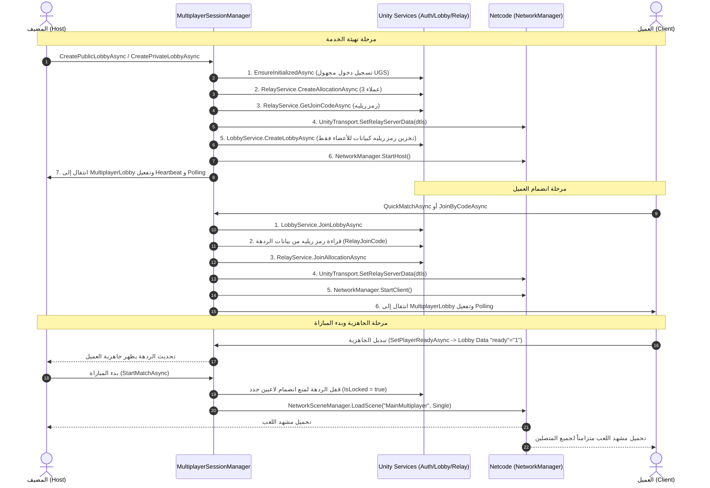

# دليل إعداد وتشغيل نظام الردهات الجماعية (Multiplayer Lobby System)
**مشروع Shootx — محرك Unity 6.3 و Netcode for GameObjects**

---

## الفهرس
1. [نظرة عامة على المعمارية (Architecture Overview)](#1-نظرة-عامة-على-المعمارية-architecture-overview)
2. [إعداد المشاهد (Scene Setup)](#2-إعداد-المشاهد-scene-setup)
3. [إعداد مدير الشبكة (NetworkManager & Persistent Root)](#3-إعداد-مدير-الشبكة-networkmanager--persistent-root)
4. [تكوين خدمات Unity Gaming Services (Lobby & Relay)](#4-تكوين-خدمات-unity-gaming-services-lobby--relay)
5. [تكوين واجهات المستخدم (UI Configuration & Hierarchy)](#5-تكوين-واجهات-المستخدم-ui-configuration--hierarchy)
6. [نظام حركات DOTween Pro](#6-نظام-حركات-dotween-pro)
7. [الربط مع المشروع الحالي (Integration with Shootx)](#7-الربط-مع-المشروع-الحالي-integration-with-shootx)
8. [خطوات الفحص والاختبار (Testing Procedures)](#8-خطوات-الفحص-والاختبار-testing-procedures)
9. [دليل استكشاف الأخطاء وحلها (Troubleshooting)](#9-دليل-استكشاف-الأخطاء-وحلها-troubleshooting)

---

## 1. نظرة عامة على المعمارية (Architecture Overview)

تم تصميم النظام ليعمل بنمط معماري نظيف يفصل تماماً بين طور اللعب الفردي (Single Player) والطور الجماعي (Multiplayer)، دون التأثير على مشهد تسجيل الدخول (`Auth`) أو مشهد القائمة الرئيسية الفردية (`Main`).

### المكونات الأساسية للطور الجماعي:

```
[مشهد Auth] (تسجيل الدخول وحفظ اسم اللاعب في PlayFab / PlayerPrefs)
      │
      ▼
[مشهد Main] (القائمة الفردية ولوحة المتصدرين)
      │  (النقر على زر طور اللعب الجماعي)
      ▼
[مشهد MultiplayerMenu] ◄─── ينشئ MultiplayerNetworkRoot + MultiplayerSessionManager (DontDestroyOnLoad)
      │  ├── البحث السريع (Quick Match)
      │  ├── استعراض الردهات العامة (Public Lobby Browser)
      │  ├── إنشاء ردهة عامة / خاصة (Create Public/Private Lobby)
      │  └── الانضمام برمز الردهة (Join Private Lobby by Code)
      ▼
[مشهد MultiplayerLobby] (غرفة الانتظار - Waiting Room)
      │  ├── قائمة 4 خانات لاعبين مع مؤشرات الجاهزية (Ready Status)
      │  ├── عرض رمز الدعوة (Lobby Code) مع زر النسخ السريع (Copy)
      │  ├── نظام الجاهزية (Ready Toggle للعملاء)
      │  └── تحكم المضيف فقط (Host-Authoritative Start Match - يتطلب 2 إلى 4 لاعبين جاهزين)
      ▼ (الانتقال عبر NetworkSceneManager التابع لـ NGO)
[مشهد MainMultiplayer] (مشهد المعركة الفعلي)
      │  ├── حركة اللاعبين والقتال (Melee / Shooting)
      │  ├── نظام الصحة والضرر (Health & Damage)
      │  └── إعادة الإحياء (Respawning)
      ▼ (عند انتهاء المباراة أو مغادرة اللاعب)
العودة النظيفة إلى [MultiplayerMenu] مع تنظيف كامل للجلسة والشبكة
```

### مخطط تدفق الاتصال (Connection Flow):



---

## 2. إعداد المشاهد (Scene Setup)

النظام يحتوي على **3 مشاهد مخصصة للعب الجماعي**:

| اسم المشهد | المسار في المشروع | الدور والوظيفة |
| :--- | :--- | :--- |
| **`MultiplayerMenu`** | `Assets/_Multiplayer/Scenes/MultiplayerMenu.unity` | نقطة الانطلاق لطور الأونلاين (بحث سريع، تصفح، إنشاء، انضمام بكود) |
| **`MultiplayerLobby`** | `Assets/_Multiplayer/Scenes/MultiplayerLobby.unity` | غرفة الانتظار (عرض رمز الردهة، الخانات الـ 4، الجاهزية، وبدء اللعبة) |
| **`MainMultiplayer`** | `Assets/_Multiplayer/Scenes/MainMultiplayer.unity` | مشهد أسلوب اللعب الحالي (القتال، الحركة، الدم، إعادة الإحياء) |

> [!IMPORTANT]
> **لماذا لا نضيف أي مكونات شبكة إلى مشهدي `Auth` و `Main`؟**
> مشهد `Auth` ومشهد `Main` مخصصان فقط لتوثيق هوية اللاعب محلياً، وحفظ البيانات الفردية، وتصفح المتصدرين عبر PlayFab. تحميل `NetworkManager` أو خدمات الشبكة داخل هذه المشاهد يسبب استهلاكاً غير مبرر للذاكرة، وتضارباً في دورة حياة الـ Singletons، وخطر تشغيل خدمات الشبكة أثناء الطور الفردي.

### الإنشاء التلقائي للمشاهد بضغطة زر (One-Click Setup):
قمنا ببناء أداة محرّر ذكية تقوم بإنشاء وتوصيل كافة المشاهد والعناصر تلقائياً دون الحاجة لتركيبها يدوياً:
1. في شريط قوائم Unity العلوي، توجه إلى:
   `Tools` ◄ `Multiplayer` ◄ `Setup All Multiplayer Scenes` (أو خيار `Build Scenes Automatically (No Dialog)`).
2. تقوم الأداة بما يلي:
   - بناء هيكل مشهد `MultiplayerMenu` وتوصيل نصوص وأزرار `MultiplayerMenuUI`.
   - بناء كائن `MultiplayerNetworkRoot` مع ضبط `NetworkManager` و `UnityTransport` تلقائياً.
   - حفظ قالب `MultiplayerNetworkRoot.prefab` وقالب `LobbyEntryPrefab.prefab`.
   - بناء هيكل مشهد `MultiplayerLobby` وتوصيل نصوص وخانات `MultiplayerLobbyUI` و `PlayerSlotUI`.
   - إضافة المشاهد الخمسة تلقائياً إلى `Build Settings`.

---

## 3. إعداد مدير الشبكة (NetworkManager & Persistent Root)

### الكائن الجذري المستمر `MultiplayerNetworkRoot`:
- يقع الكائن في مشهد `MultiplayerMenu`.
- يحتوي على المكونات التالية معاً على نفس الكائن:
  1. **`MultiplayerNetworkRoot`** (MonoBehaviour): يتولى استمرار الكائن عبر `DontDestroyOnLoad` ومنع تكراره إذا عاد اللاعب للقائمة.
  2. **`NetworkManager`** (Netcode for GameObjects 2.13.3).
  3. **`UnityTransport`** (Unity.Netcode.Transports.UTP).

### الإعدادات البرمجية الدقيقة لـ `NetworkManager`:
- **Network Transport:** مرتبط بمكون `UnityTransport` على نفس الكائن.
- **Player Prefab:** معين على مجسم اللاعب الموجود في:
  `Assets/_Multiplayer/Players/Prefabs/Player.prefab`
- **Network Prefabs Lists:** يحتوي على القائمة الأصلية للمشروع:
  `Assets/DefaultNetworkPrefabs.asset`
- **Enable Scene Management:** مفعل (`true`)، وهو المسؤول عن نقل جميع العملاء مع المضيف تلقائياً عند استدعاء تحميل مشهد `MainMultiplayer`.
- **Tick Rate:** محدد بـ `30` دورة في الثانية لضمان الأداء السلس على أجهزة الجوال (Android و iOS).

### التعامل مع `NetworkManager` في مشهد `MainMultiplayer`:
- عند انتقال المضيف والعملاء من `MultiplayerLobby` إلى `MainMultiplayer`، ينتقل معهم `MultiplayerNetworkRoot` المستمر.
- يحتوي كود `MultiplayerNetworkRoot` على فحص لمنع التكرار؛ كما أن `NetworkManager` في Netcode 2.13.3 يقوم بتدمير أي كائن `NetworkManager` إضافي يظهر في المشهد المحلي تلقائياً دون إفساد الاتصال القائم.

---

## 4. تكوين خدمات Unity Gaming Services (Lobby & Relay)

### تهيئة الخدمات والتوثيق (`MultiplayerServiceManager`):
- يتم استدعاء التوثيق تلقائياً عبر `MultiplayerServiceManager.EnsureInitializedAsync()`.
- يتم تسجيل الدخول مجهولاً (Anonymous Sign-in) عبر Unity Authentication Service (UGS)، وهو مستقل تماماً عن PlayFab ولا يتعارض معه.
- آمن ضد الاستدعاءات المتزامنة (`TaskCompletionSource`)؛ فإذا ضغط اللاعب عدة أزرار فلن تتكرر عملية التوثيق.

### ردهات اللعب وتخصيص ريليه (Relay Allocation):
1. **الحد الأقصى للاعبين:** 4 لاعبين كحد أقصى (مضيف + 3 عملاء).
2. **الحد الأدنى لبدء اللعبة:** لاعبان اثنان (مضيف + عميل واحد على الأقل).
3. **تخصيص Relay:** يقوم المضيف بطلب `RelayService.Instance.CreateAllocationAsync(3)`.
4. **الفرق بين الرمزين (مهم جداً):**
   - **رمز الردهة (Lobby Code):** رمز نصي قصير من 6 أحرف/أرقام يتم إنشاؤه بواسطة خدمة Unity Lobby، وهو الرمز الذي يشاركه اللاعبون مع أصدقائهم (مثل `X9B2K1`).
   - **رمز انضمام ريليه (Relay Join Code):** رمز تقني داخلي صادر عن خوادم Relay، يتم حفظه داخل بيانات الردهة بصفة خاصة بالأعضاء فقط (`VisibilityOptions.Member`) تحت المفتاح `"rjc"`. لا يحتاج اللاعب لحفظه أو إدخاله يدوياً؛ حيث يقرأه العميل برمجياً فور دخوله الردهة عبر كود الردهة أو المتصفح.

### إدارة دورة حياة الردهة (Heartbeat & Polling):
- **نبض الردهة (Heartbeat):** يُرسل المضيف نبضة كل 15 ثانية (`SendHeartbeatPingAsync`) لمنع خوادم Unity من إغلاق الردهة بسبب الخمول.
- **تحديث بيانات الردهة (Lobby Polling):** يقوم كل جهاز بعمل استعلام خفيف كل ثانيتين (`GetLobbyAsync`) لتحديث قائمة اللاعبين، مؤشرات الجاهزية، ومراقبة حالة القفل أو الحذف.

### نظام الجاهزية (Ready System):
- يتم حفظ جاهزية كل لاعب داخل بيانات اللاعب في الردهة (`PlayerDataObject`) تحت المفتاح `"ready"`.
- المضيف يُعتبر جاهزاً تلقائياً.
- زر **Start Match** لا يظهر إلا للمضيف فقط، ويكون غير مفعل (Disabled) حتى تكتمل الشروط:
  1. عدد اللاعبين بين 2 و 4.
  2. جميع العملاء المنضمين قاموا بتفعيل خيار "Ready".
  3. الردهة ليست في حالة بدء سابقة.

---

## 5. تكوين واجهات المستخدم (UI Configuration & Hierarchy)

تم بناء الواجهات بنمط عصري ومرن (Themeable) يسهل تخصيصه بالألوان والأصول الفنية التي تختارها لاحقاً:

### هيكل مشهد `MultiplayerMenu`:
```
MenuCanvas (Canvas, CanvasScaler 1080x1920 Match 0.5, GraphicRaycaster, MultiplayerMenuUI)
 ├── MainMenuPanel (CanvasGroup, RectTransform)
 │    ├── PlayerNameText (TextMeshProUGUI - يعرض الاسم المسترجع من PlayerPrefs)
 │    ├── QuickMatchButton (Button + TextMeshProUGUI)
 │    ├── BrowseLobbiesButton (Button + TextMeshProUGUI)
 │    ├── CreatePublicButton (Button + TextMeshProUGUI)
 │    ├── CreatePrivateButton (Button + TextMeshProUGUI)
 │    ├── JoinByCodeButton (Button + TextMeshProUGUI)
 │    └── BackButton (Button + TextMeshProUGUI - العودة لمشهد Main)
 ├── BrowserPanel (CanvasGroup)
 │    ├── BrowserTitle (TextMeshProUGUI)
 │    ├── RefreshButton (Button + TextMeshProUGUI)
 │    ├── BrowserBackButton (Button + TextMeshProUGUI)
 │    ├── LobbyListScrollArea (RectTransform)
 │    │    └── LobbyListContent (VerticalLayoutGroup, ContentSizeFitter)
 │    ├── EmptyListText (TextMeshProUGUI - يظهر عند عدم وجود غرف)
 │    └── BrowserLoadingIndicator (GameObject)
 ├── JoinCodePanel (CanvasGroup)
 │    ├── JoinCodeTitle (TextMeshProUGUI)
 │    ├── CodeInput (TMP_InputField)
 │    ├── JoinCodeConfirmButton (Button)
 │    └── JoinCodeBackButton (Button)
 ├── CreatePanel (CanvasGroup)
 │    ├── CreateTitleText (TextMeshProUGUI)
 │    ├── LobbyNameInput (TMP_InputField)
 │    ├── CreateConfirmButton (Button)
 │    └── CreateBackButton (Button)
 ├── LoadingPanel (CanvasGroup - حاجز معتم مع مؤشر دوران أثناء انتظار الشبكة)
 │    ├── LoadingText (TextMeshProUGUI)
 │    └── LoadingSpinner (Image يدور بحركة سلسة)
 └── NotificationPanel (CanvasGroup - رسائل الخطأ والتنبيه المنبثقة)
      ├── NotificationText (TextMeshProUGUI)
      └── NotificationDismissButton (Button)
```

### هيكل مشهد `MultiplayerLobby` (غرفة الانتظار):
```
LobbyCanvas (Canvas, CanvasScaler, GraphicRaycaster, MultiplayerLobbyUI)
 ├── HeaderPanel (CanvasGroup)
 │    ├── LobbyNameText (TextMeshProUGUI - اسم الغرفة)
 │    ├── PlayerCountText (TextMeshProUGUI - مثل "3/4")
 │    └── HostIndicatorText (TextMeshProUGUI - "You are the Host" أو "Waiting Room")
 ├── CodePanel (CanvasGroup)
 │    ├── CodeLabel (TextMeshProUGUI - "Lobby Code:")
 │    ├── LobbyCodeText (TextMeshProUGUI - كود الغرفة المكون من 6 خانات)
 │    └── CopyCodeButton (Button - نسخ الرمز للحافظة مع إشعار "Copied!")
 ├── PlayerSlotsContainer (VerticalLayoutGroup - يحتوي 4 خانات ثابتة)
 │    ├── PlayerSlot_1 (PlayerSlotUI)
 │    ├── PlayerSlot_2 (PlayerSlotUI)
 │    ├── PlayerSlot_3 (PlayerSlotUI)
 │    └── PlayerSlot_4 (PlayerSlotUI)
 ├── ControlsPanel (CanvasGroup)
 │    ├── ReadyButton (Button - يظهر للعملاء فقط لتبديل حالة الجاهزية)
 │    ├── StartMatchButton (Button - يظهر للمضيف فقط ويفعل عند جاهزية الجميع)
 │    ├── LeaveButton (Button - مغادرة الردهة والعودة للقائمة)
 │    └── StatusLabel (TextMeshProUGUI - نصوص توجيهية وحالة الاتصال)
 ├── StatusPanel (CanvasGroup - مؤشر تحميل منبثق)
 └── NotificationPanel (CanvasGroup - نوافذ التنبيهات والأخطاء)
```

### تفاصيل مكون خانة اللاعب (`PlayerSlotUI`):
تحتوي كل خانة على حالتين متمايزتين يتم التبديل بينهما بالحركة:
- **الحالة المشغولة (OccupiedContent):** تعرض اسم اللاعب، شارة المضيف (`HOST`) إذا كان هو المنشئ، ومؤشر الجاهزية (`READY` باللون الأخضر أو `NOT READY` باللون البرتقالي).
- **الحالة الفارغة (EmptyContent):** تعرض نص *"Waiting for player..."* بخلفية شبه شفافة.

---

## 6. نظام حركات DOTween Pro

تم توظيف مكتبة **DOTween Pro** وفقاً للأعلى معايير لتقديم تجربة استخدام راقية ومحترفة دون التأثير على استقرار الشبكة:

1. **انتقال اللوحات (Panels Transitions):**
   - استخدام `CanvasGroup.DOFade` مع `RectTransform.DOScale` وتدرج `Ease.OutBack` لظهور النوافذ بسلاسة.
   - إخفاء اللوحات بتدرج `Ease.InBack` وتثبيط `interactable` و `blocksRaycasts` أثناء الحركة لمنع النقر المزدوج.
2. **أزرار القائمة (Staggered Animations):**
   - ظهور أزرار القائمة الرئيسية بشكل متتابع وفارق زمني لطيف (`slotStaggerDelay = 0.08s`).
3. **تفاعل النقر (Micro-Interactions):**
   - كل زر ينضغط للداخل بنسبة 0.9 ثم يرتد للحجم الطبيعي بنمط بونسي (`DOPunchScale` / `DOScale`).
4. **تحديث الجاهزية ودخول اللاعبين:**
   - عند انضمام لاعب لخانات الغرفة، تتسع الخانة بحركة مرنة (`Ease.OutBack`).
   - عند تغيير الجاهزية، يتغير لون خلفية الخانة بنعومة (`DOColor`) مع حركة ارتداد خفيفة (`DOPunchScale`).
5. **مؤشر التحميل الدائري (Loading Spinner):**
   - دوران لا نهائي سلس عبر `DORotate(..., -360, RotateMode.FastBeyond360).SetEase(Ease.Linear).SetLoops(-1)`.
6. **إدارة دورة حياة الحركات (Tween Safety):**
   - استدعاء `DOKill()` قبل تشغيل أي حركة جديدة لمنع تضارب الحركات السابقة.
   - قتل كافة الحركات في دوال `OnDestroy()` لحماية الذاكرة من التسريب وعدم استدعاء كود على كائنات ملغاة بعد تغيير المشهد.

---

## 7. الربط مع المشروع الحالي (Integration with Shootx)

### 1. مصدر اسم اللاعب (Player Name):
يقرأ النظام اسم اللاعب مباشرة من الإعدادات المحفوظة التي ينتجها نظام PlayFab الحالي للمشروع عبر:
```csharp
string playerName = PlayerPrefs.GetString(PlayFabLoginManager.PlayerNameKey, "");
```
إذا لم يكن الاسم موجوداً (مثلاً عند الاختبار المباشر من المحرر)، يوفر النظام اسماً افتراضياً آمناً تلقائياً بصيغة `Player_XXXX` دون التسبب في أي انهيار.

### 2. الربط من القائمة الرئيسية الفردية (`Main`):
للانتقال من القائمة الحالية لمشروعك إلى طور الأونلاين الجديد، اربط الزر المخصص للملتي بلاير في مشهد `Main` بتحميل المشهد برمجياً أو عبر المفتش (Inspector):
```csharp
UnityEngine.SceneManagement.SceneManager.LoadScene("MultiplayerMenu");
```
*ملاحظة: لا حاجة لإضافة أي سكربتات شبكة في مشهد `Main`.*

### 3. تنظيف الجلسة والعودة للطور الفردي (Safe Return):
عند نقر اللاعب على زر العودة (Back) في `MultiplayerMenu`:
- يقوم الكود بحذف الكائنات المستمرة `MultiplayerSessionManager` و `MultiplayerNetworkRoot`.
- يتم إغلاق NGO بأمان والعودة لمشهد `Main` نظيفاً بالكامل دون ترك أي اتصالات معلقة أو استخدام غير مبرر للإنترنت.

---

## 8. خطوات الفحص والاختبار (Testing Procedures)

لإجراء اختبار شامل والتأكد من استيفاء كافة المعايير، اتبع الخطوات التالية:

### قائمة الفحص الأولي:
- [ ] التأكد من وجود المشاهد الخمسة في نافذة `File` ◄ `Build Profiles` / `Build Settings`:
  1. `Assets/Scenes/Auth.unity`
  2. `Assets/Scenes/Main.unity`
  3. `Assets/_Multiplayer/Scenes/MultiplayerMenu.unity`
  4. `Assets/_Multiplayer/Scenes/MultiplayerLobby.unity`
  5. `Assets/_Multiplayer/Scenes/MainMultiplayer.unity`
- [ ] التأكد من أن خدمات Unity Gaming Services مفعلة في مشروعك وتملك Project ID صالحاً ومرتبطاً بـ Lobby و Relay في لوحة تحكم Unity Dashboard.

---

### سيناريوهات الاختبار خطوة بخطوة:

#### 1. اختبار إنشاء ردهة عامة (Host Public Lobby):
1. افتح مشهد `MultiplayerMenu` وشغل اللعبة في Unity Editor.
2. اضغط على **Create Public Lobby** ثم اكتب اسماً للغرفة واضغط **Create**.
3. **النتيجة المتوقعة:**
   - يظهر مؤشر التحميل "Creating public lobby...".
   - يتم تخصيص Relay وبدء NGO Host بنجاح.
   - ينتقل المشهد تلقائياً إلى `MultiplayerLobby`.
   - يظهر اسمك في الخانة الأولى مع شارة `HOST`.
   - يظهر كود الردهة في الأعلى، ويكون زر "Start Match" غير مفعّل (Disabled) لأن العدد 1/4 فقط.

#### 2. اختبار الانضمام السريع واستعراض الردهات (Client Joining):
*يتطلب بناء نسخة Build تجريبية من اللعبة أو استخدام ParrelSync / جهاز جوال متصل:*
1. شغّل النسخة الأولى كمضيف كما في الخطوة السابقة.
2. في النسخة الثانية، افتح `MultiplayerMenu` واضغط **Browse Lobbies**.
3. **النتيجة المتوقعة:**
   - تظهر ردهة المضيف في القائمة مع اسم الغرفة وعدد اللاعبين `1/4` وزر `Join`.
   - اضغط `Join`، فيتم الاتصال عبر Relay ودخول نفس الردهة في الخانة الثانية.
   - يتحدث عداد اللاعبين لدى المضيف والعميل فورياً إلى `2/4`.

#### 3. اختبار الردهة الخاصة ورمز الدعوة (Private Lobby by Code):
1. في النسخة الأولى، أنشئ ردهة خاصة عبر **Create Private Lobby**.
2. لن تظهر هذه الردهة في قائمة متصفح الردهات العامة (Browser).
3. اضغط زر **Copy** لنسخ رمز الردهة المكون من 6 أحرف.
4. في النسخة الثانية، اختر **Join by Code**، والصق الرمز واضغط **Join**.
5. **النتيجة المتوقعة:** يدخل العميل بنجاح إلى الغرفة الخاصة للمضيف.

#### 4. اختبار شروط الجاهزية وبدء المباراة (Ready & Start Authority):
1. بوجود لاعبين في الردهة (المضيف والعميل):
   - يرى المضيف نص زر البدء: *"Waiting for Ready..."* ولا يمكنه النقر عليه.
2. يضغط العميل على زر **Ready**:
   - يتحول زر العميل إلى *"Not Ready"* باللون البرتقالي، وتتحول خانته إلى علامة `READY` الخضراء بحركة ارتداد لطيفة.
   - يتفعل زر **Start Match** لدى المضيف ويصبح نابضاً وقابلاً للنقر.
3. يضغط المضيف على **Start Match**:
   - يتم قفل الردهة برمجياً.
   - ينقل `NetworkSceneManager` كلاً من المضيف والعميل متزامنين إلى مشهد المعركة `MainMultiplayer`.
   - يتولد مجسم اللاعب لكل منهما في نقاط التوليد وتعمل أنظمة الحركة والقتال والصحة بسلاسة.

#### 5. اختبار رفض اللاعب الخامس (Player Limit Enforcement):
1. عندما تكتمل الردهة بـ 4 لاعبين (1 مضيف + 3 عملاء)، تصبح سعة الغرفة `4/4`.
2. يحاول جهاز خامس الانضمام برمز الدعوة أو عبر البحث.
3. **النتيجة المتوقعة:** يرفض خادم الردهة الطلب مع إظهار نافذة إشعار بالخطأ توضح أن الردهة ممتلئة، دون أن ينهار التطبيق.

#### 6. اختبار الخروج النظيف وفصل الاتصال (Clean Disconnects):
- **خروج العميل طوعياً:** يضغط العميل على **Leave Lobby**. يتم إخراجه من الردهة والشبكة ويعود إلى `MultiplayerMenu`. تفرغ خانته لدى المضيف وتعود الردهة لحالة الانتظار.
- **خروج المضيف طوعياً:** يضغط المضيف على **Leave Lobby**. يتم حذف الردهة من خوادم Unity، وإيقاف الـ Host، ويعود العملاء تلقائياً وبأمان إلى `MultiplayerMenu` دون التجمد.
- **انقطاع الاتصال المفاجئ (Unexpected Drop):** إذا تم إغلاق تطبيق المضيف قسراً، يستشعر العميل انقطاع اتصال NGO (`OnClientDisconnected`)، فيقوم بتنظيف موارده والعودة تلقائياً لقائمة البداية.

---

## 9. دليل استكشاف الأخطاء وحلها (Troubleshooting)

| المشكلة أو رسالة الخطأ | السبب المحتمل | الحل المباشر |
| :--- | :--- | :--- |
| **`LobbyNotFound` أو `Lobby is no longer available`** | الردهة تم حذفها لمغادرة المضيف أو انتهاء صلاحيتها. | يتم التعامل معها برمجياً لتعيد اللاعب للقائمة. تحقق من إدخال الرمز بدقة بدون مسافات إضافية. |
| **`RelayAllocationException` أو `Forbidden`** | خدمة Unity Relay غير مفعلة في لوحة التحكم أو غير مقترنة بمشروعك. | افتح [Unity Dashboard](https://cloud.unity.com/) ◄ توجه إلى قسم **Relay** و **Lobby** وتأكد من تفعيلهما لنفس الـ Project ID. |
| **`Multiple NetworkManagers detected`** | وجود كائن NetworkManager مكرر في المشهد. | تم بناء كائن `MultiplayerNetworkRoot` ليعالج التكرار تلقائياً عبر `DontDestroyOnLoad`. تأكد من أنك تستخدم النسخة المنشأة بواسطة أداة الإعداد في المشاهد. |
| **`Rate limit exceeded` (429)** | إرسال طلبات سريعة جداً تفوق حدود خوادم Unity Lobby المجانية. | تم ضبط وتيرة النبض على 15 ثانية، واستعلام الردهة على ثانيتين لتبقى ضمن الحدود المسموحة تماماً. تجنب النقر المتكرر السريع على زر Refresh. |
| **العميل لا ينتقل مع المضيف عند بدء اللعبة** | خيار `EnableSceneManagement` غير مفعل على `NetworkManager`. | افتح كائن `MultiplayerNetworkRoot` في مشهد `MultiplayerMenu`، وتأكد من تحديد علامة الصح أمام `Enable Scene Management` في قسم NetworkConfig. |
| **اللاعب يظهر بدون اسم أو باسم افتراضي** | مفتاح اسم اللاعب غير مخزن في `PlayerPrefs`. | تأكد من تسجيل الدخول عبر مشهد `Auth` أولاً ليتم حفظ الاسم في `PlayFabLoginManager.PlayerNameKey`. |

---
**النظام جاهز تماماً للاستخدام، ومتكامل كلياً مع كود وبيئة محرك Unity 6.3 و Netcode 2.13.3.**
